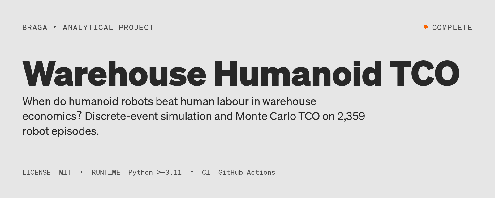
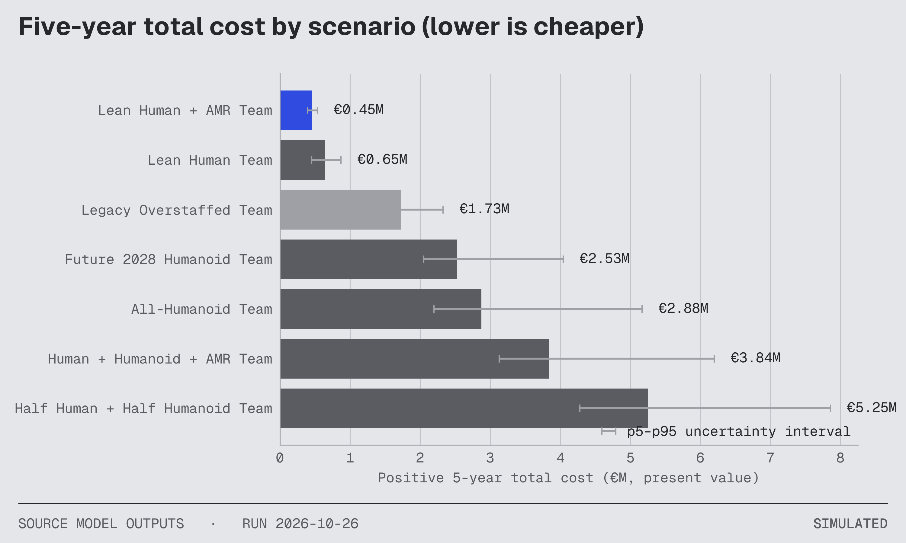
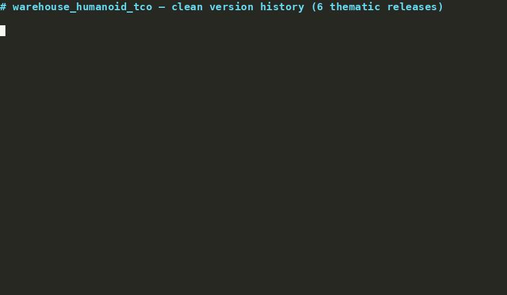
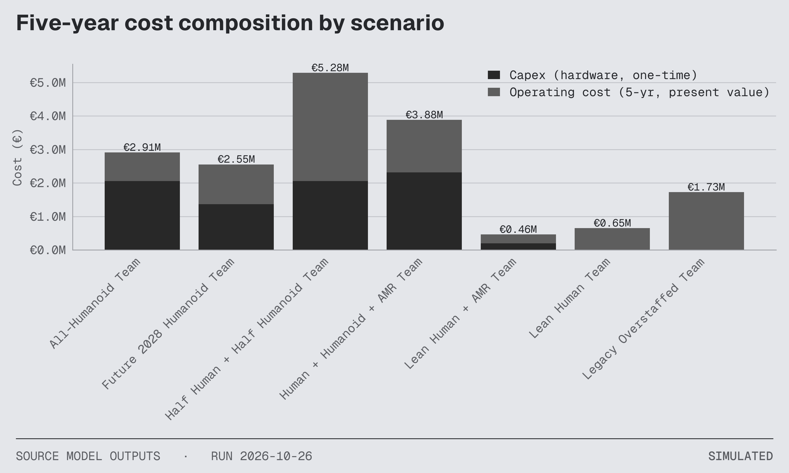
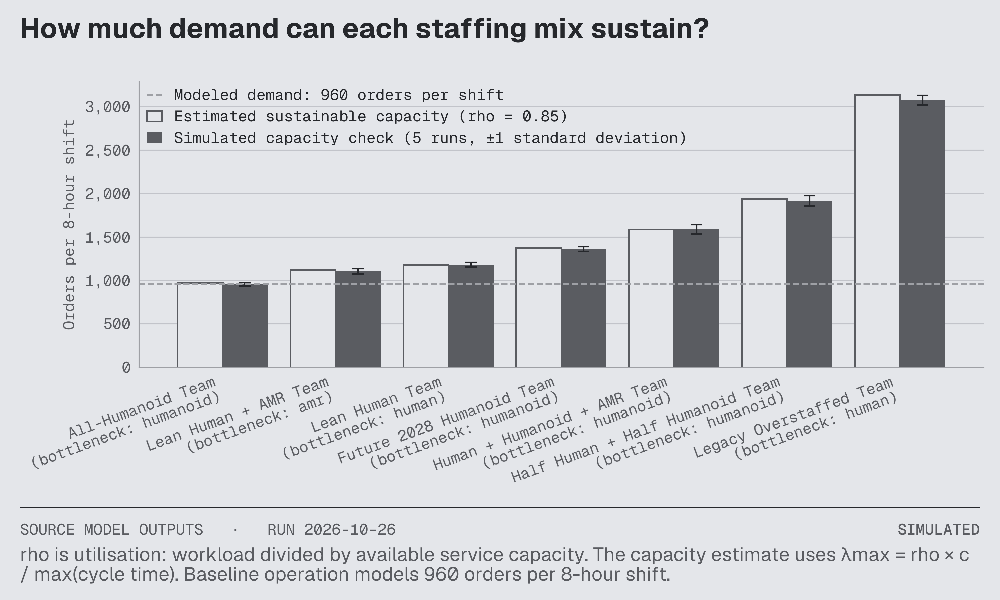
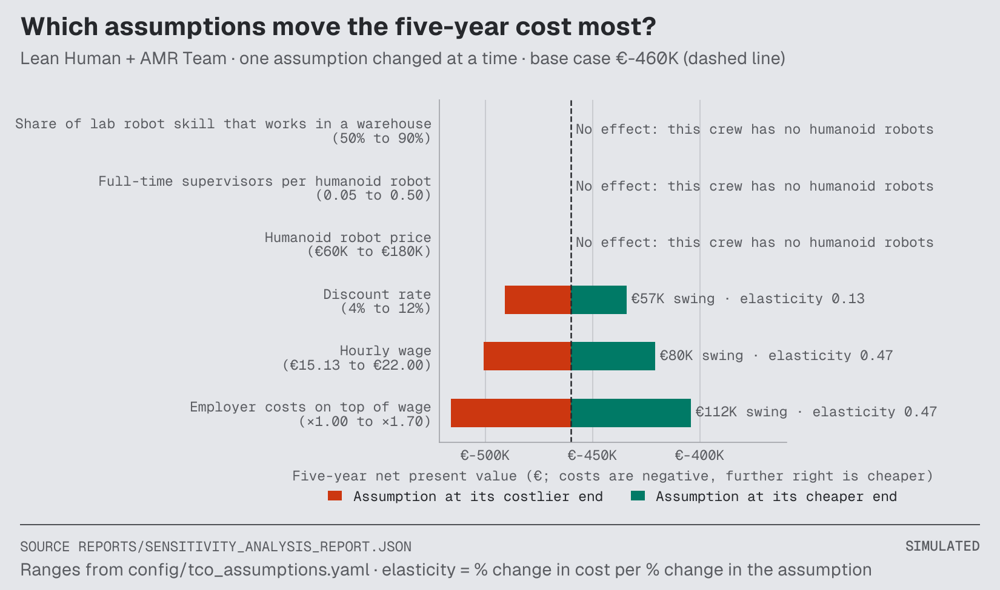
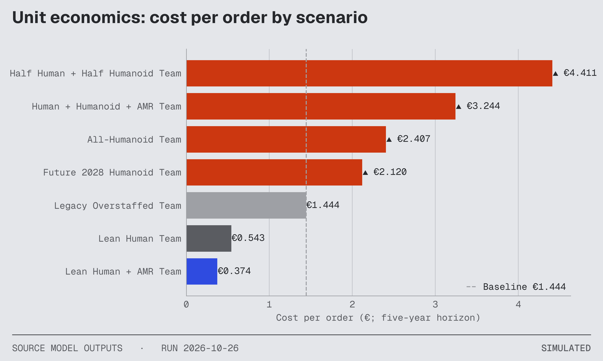
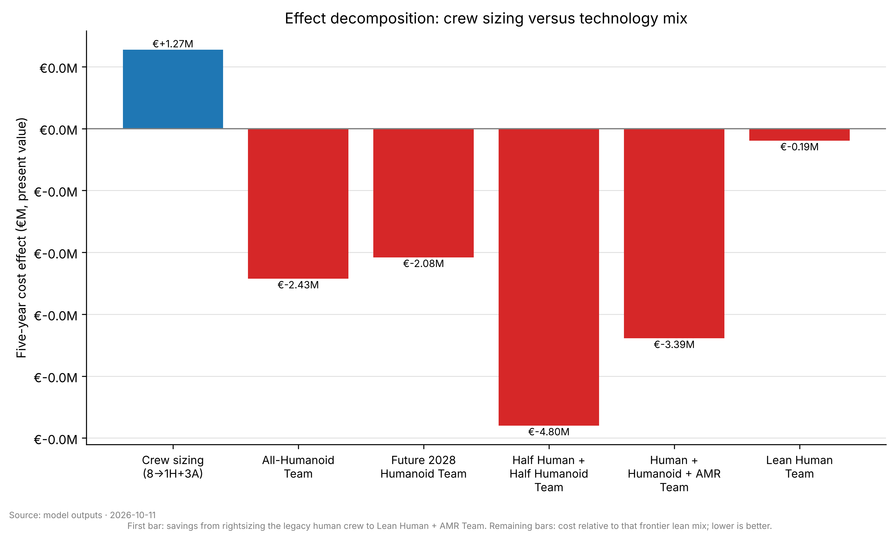
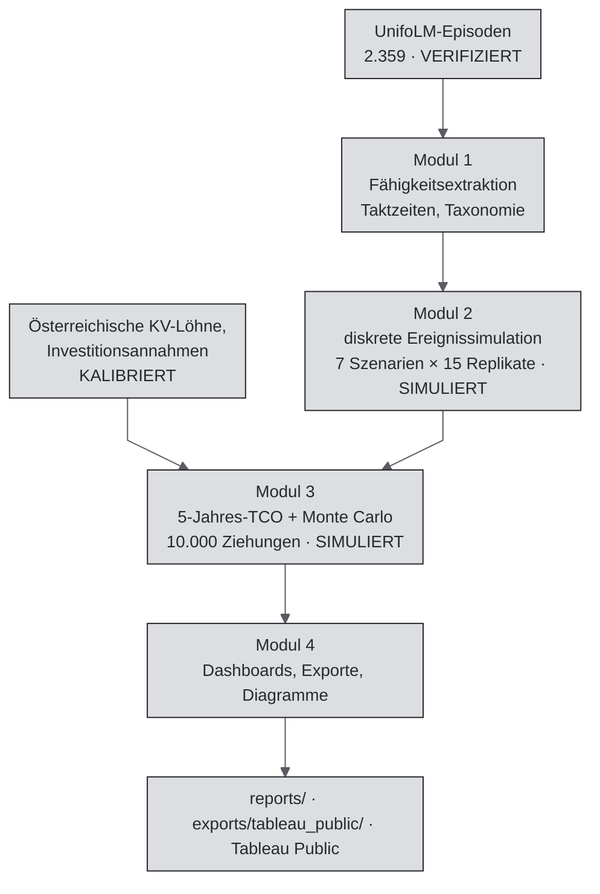

[🇧🇷 PT-BR](README.pt-BR.md) · [🇬🇧 EN-UK](README.md) · [🇦🇹 DE-AT](README.de-AT.md)

# TCO humanoider Roboter im Lager



[](https://github.com/RafaelBraga-Kribitz/warehouse_humanoid_tco/actions/workflows/ci.yml)
[](https://github.com/RafaelBraga-Kribitz/warehouse_humanoid_tco/actions/workflows/reproducibility.yml)
[](https://www.python.org/downloads/release/python-3110/)
[](LICENSE)
[](governance/AUDIT_PROCEDURE.md)
[](#status)

**Status:** Abgeschlossen

Wann rechnen sich humanoide Roboter im Lager gegenüber menschlicher Arbeit? Dieses Projekt vergleicht sieben Lagerteams anhand der fünfjährigen [Total Cost of Ownership (TCO)](./docs/glossary.md#tco). Es unterstützt eine Entscheidung: welches Team finanziert werden soll.

> - **Wer entscheidet:** der COO oder Standortleiter eines österreichischen Lagers der AutoStore-Klasse.
> - **Was entschieden wird:** wohin das Investitionsbudget (einmalige Hardwareausgaben) fließt: in humanoide Roboter, Roboterwagen (AMR, autonome mobile Roboter) oder ausschließlich in Beschäftigte.
> - **Ergebnis:** Finanziert werden soll die schlanke Kombination aus einer Arbeitskraft und drei Roboterwagen. Über fünf Jahre beträgt ihr Barwert in heutigem Geld €0,45 Mio. gegenüber €0,65 Mio. für den fairen Vergleich, ein Team mit drei Arbeitskräften. Die modellierte Ersparnis beträgt rund €0,195 Mio. (€194.695). Die modellierte Alt-Referenz mit acht Arbeitskräften kostet €1,73 Mio. Kein Team mit Humanoiden ist günstiger als diese Referenz. <!-- claim: reports/module_03_tco_report.json::scenario_results[4].npv_eur [eur_m]; reports/module_03_tco_report.json::scenario_results[5].npv_eur [eur_m]; reports/module_03_tco_report.json::scenario_results[6].npv_eur [eur_m] -->
> - **Wichtigster Vorbehalt:** Die Geschwindigkeitsdaten der Roboter stammen aus Haushaltstätigkeiten, nicht aus Lageraufgaben. Dies ist ein modellierter Vergleich und kein Angebot für einen bestimmten Standort. Die schlanke Kombination enthält keine humanoiden Roboter und verwendet daher nicht den Geschwindigkeitsfaktor aus Haushaltstätigkeiten.
> - **Diagramm:** [Fünfjahres-Gesamtkosten für sieben Teams](#was-die-zahlen-aussagen).

## Entscheidungsübersicht

### Entscheidung und Legende

> **Empfehlung:** Das schlanke Team aus Mensch und AMR (1 Arbeitskraft + 3 AMR) jetzt einsetzen und die Beschaffung von Humanoiden aufschieben: Bei 120 Aufträgen pro Stunde erreicht kein reines Humanoid-Team mit Investitionskosten im untersuchten Bereich von €10.000 bis €500.000 die Kostenparität mit dieser schlanken Frontier-Kombination. Selbst nahezu kostenlose Humanoide schneiden schlechter ab als 1 Arbeitskraft + 3 AMR. Die Investitionskosten sind daher nicht der entscheidende Engpass. Bei steigender Nachfrage, Arbeitskräftemangel oder Mehrschichtbetrieb erneut prüfen (siehe `reports/demand_frontier.json`). Integrationskosten und Verfügbarkeitsabschläge sind modelliert (F-222). <!-- claim: reports/module_03_tco_report.json::breakeven_thresholds.vs_lean_human.no_breakeven_in_search_range; reports/module_03_tco_report.json::breakeven_thresholds.vs_lean_human.search_range_eur -->
> In der österreichischen Intralogistik sind nicht Lohnkostenvorteile, sondern unbesetzbare Stellen der praktische Automatisierungstreiber. Das Modell nimmt vorsichtshalber an, dass Arbeitskräfte zu KV-Sätzen verfügbar sind. Wo Stellen unbesetzt bleiben, wird der Wert von Robotern daher unterschätzt.

Legende: Dies ist die in [PROJECT_CHARTER.md](./PROJECT_CHARTER.md) festgehaltene Entscheidung. F-222 bezeichnet den dokumentierten Befund zu Integrationskosten und Verfügbarkeitsabschlägen (Roboter stehen nicht jederzeit zur Verfügung). 1H+3A bedeutet eine Arbeitskraft plus drei Roboterwagen. KV steht für den österreichischen Kollektivvertrag.

### Was die Zahlen aussagen

Bei der modellierten Nachfrage ist die schlanke Kombination das günstigste Team, das jede Ressource bei höchstens 85 % Auslastung hält. Das Team mit drei Arbeitskräften und ohne Roboter kostet €0,65 Mio. (€647.401). Es ist der Vergleich ausschließlich mit menschlicher Arbeit. Von den Teams mit humanoiden Robotern ist das Humanoid-Team 2028 am günstigsten (€2,53 Mio. bzw. €2.532.753). Es ist dennoch teurer als die modellierte Alt-Referenz mit acht Arbeitskräften. Diese Referenz ist ein modelliertes, überbesetztes Team. Keine Quelle belegt einen realen Standort mit acht Arbeitskräften. Sie ist daher keine faire technologische Vergleichsbasis; fair ist der Vergleich mit drei Arbeitskräften. <!-- claim: reports/module_03_tco_report.json::scenario_results[5].npv_eur [eur_m]; reports/module_03_tco_report.json::scenario_results[1].npv_eur [eur_m] -->



*Kosten jedes Teams über fünf Jahre, in heutigem Geld. Die hervorgehobene schlanke Kombination kostet €0,45 Mio. gegenüber €1,73 Mio. für die modellierte Alt-Referenz mit acht Arbeitskräften. Jedes Team mit humanoiden Robotern ist teurer als die Alt-Referenz. Graue Fehlerbalken zeigen den Bereich vom 5. bis zum 95. Perzentil über 10.000 Monte-Carlo-Ziehungen. Beschriftungen sind auf €0,01 Mio. gerundet; die Teamtabelle enthält die exakten Eurobeträge. Im Diagramm bezeichnet „Lean Human + AMR Team“ die schlanke Kombination und „Legacy Overstaffed Team“ die modellierte Alt-Referenz mit acht Arbeitskräften.* <!-- claim: reports/module_03_tco_report.json::scenario_results[4].npv_eur [eur_m]; reports/module_03_tco_report.json::scenario_results[6].npv_eur [eur_m] -->

## Warum es dieses Projekt gibt

Österreichische Lagerbetreiber erhalten Angebote für humanoide Roboter, die sich auf Herstellerdemos stützen. Gleichzeitig müssen sie die Teams dimensionieren, die neben den Robotern kommissionieren. Dieses Projekt sollte einem COO zeigen, wie viele Kommissionierkräfte eine AutoStore-Zelle benötigt und ob zwei Humanoide pilotiert werden sollten oder ob man besser wartet. Die Bewertung vor dem Bau erwartete einen Entscheidungsnutzen von €53.000 bei zentralen Kosten von €11.124. Das entspricht Faktor 4,8 und überschreitet knapp die finanzielle Hürde von Faktor 4. Beobachtetes Ergebnis: noch nicht gemessen; es liegt keine Betreiberentscheidung vor. Details: [wirtschaftliche Bewertung](docs/economic-evaluation.md). <!-- claim: structural -->

## In Ausführung ansehen



*`make all` führt die vier Pipeline-Stufen aus (Fähigkeitsextraktion, Simulation, TCO, Dashboards). Alle Diagramme und Tabellen dieser Seite werden in `reports/` und `exports/` geschrieben. Aufzeichnung: [`docs/assets/demo.cast`](./docs/assets/demo.cast).*

Interaktive Ansicht: [Tableau-Public-Dashboard](https://public.tableau.com/app/profile/rafael.braga.kribitz/viz/HumanoidRoboticsTCO/Dashboard1), gespeist aus den CSV-Dateien unter [`exports/tableau_public/`](./exports/tableau_public/). Die SQL-Herkunft der CSVs ist unter [`analytics/sql/`](./analytics/sql/) dokumentiert (DuckDB; Parität durch CI geprüft).

## Dieses Projekt erkunden

| Zielgruppe | Einstieg |
|---------|------|
| **Recruiter (2 Min.)** | [PDF auf Deutsch](./reports/Executive_Summary_DE.pdf) · [PDF auf Englisch](./reports/Executive_Summary_EN.pdf) · [Exhibit-Präsentation](./reports/exhibit_deck.pdf) · [Tableau Public](https://public.tableau.com/app/profile/rafael.braga.kribitz/viz/HumanoidRoboticsTCO/Dashboard1) · [60-Sekunden-Rundgang](./docs/walkthrough_60s.md) |
| **Hiring Manager (10 Min.)** | [Entscheidungsfeld oben](#entscheidungsübersicht) · [Ergebnisse der EXPERIMENTE](./governance/EXPERIMENTS.md) · [Datenherkunft](./docs/data_lineage.md) · [EINSCHRÄNKUNGEN](./governance/LIMITATIONS.md) |
| **Auditoren** | [Governance](./governance/README.md) · [AUDIT_STATE](./governance/AUDIT_STATE.json) · [QUALITY_BLUEPRINT](./governance/QUALITY_BLUEPRINT.md) |

## Ergebnisse

### Fünfjahres-Gesamtkosten von sieben Teams

Das Modell nutzt einen Zeithorizont von fünf Jahren und einen jährlichen Diskontsatz von 8 %. <!-- claim: reports/module_03_tco_report.json::discount_rate [pct] --> Auf dieser Seite werden Gesamtkosten durchgehend als positive Werte dargestellt. Die Gesamtkosten entsprechen Investitionskosten plus Betriebskosten, auf heutige Werte abgezinst, abzüglich des Restwerts der Roboter im fünften Jahr.[^opex] In der letzten Spalte bedeutet ein Pluszeichen höhere Kosten und ein Minuszeichen eine Ersparnis. Das Team Lean Human + AMR ist unter der Regel „höchstens 85 % Auslastung je Ressource“ am günstigsten. Ein Roboterwagen (AMR) ist ein fahrbarer Wagenroboter, kein humanoider Roboter mit Armen und Beinen. <!-- claim: structural -->

| Team | Diagrammbezeichnung | Gesamtkosten über 5 Jahre, Barwert (Beschriftung in Diagramm 1) | Investitionskosten | Betriebskosten über 5 Jahre (nicht abgezinst) | Kosten je Auftrag | Kostenänderung gegenüber der Alt-Referenz mit 8 Arbeitskräften |
| --- | --- | --- | --- | --- | --- | --- |
| **Schlanke Kombination: 1 Arbeitskraft + 3 Roboterwagen** | Lean Human + AMR Team | **€452.706 (€0,45 Mio.)** | **€195.000** | **€333.097** | **€0,374** | **-73,8 %** | <!-- claim: reports/module_03_tco_report.json::scenario_results[4].npv_eur [eur]; reports/module_03_tco_report.json::scenario_results[4].total_capex_eur [eur]; reports/module_03_tco_report.json::scenario_results[4].total_opex_5yr_eur_nominal [eur]; reports/module_03_tco_report.json::scenario_results[4].cost_per_order_eur [eur]; reports/module_03_tco_report.json::scenario_results[4].total_cost_reduction_vs_baseline_pct [pct] -->
| 3 Arbeitskräfte, keine Roboter | Lean Human Team | €647.401 (€0,65 Mio.) | €0 | €813.811 | €0,543 | -62,5 % | <!-- claim: reports/module_03_tco_report.json::scenario_results[5].npv_eur [eur]; reports/module_03_tco_report.json::scenario_results[5].total_capex_eur [eur]; reports/module_03_tco_report.json::scenario_results[5].total_opex_5yr_eur_nominal [eur]; reports/module_03_tco_report.json::scenario_results[5].cost_per_order_eur [eur]; reports/module_03_tco_report.json::scenario_results[5].total_cost_reduction_vs_baseline_pct [pct] -->
| Modellierte Alt-Referenz mit 8 Arbeitskräften | Legacy Overstaffed Team | €1.726.403 (€1,73 Mio.) | €0 | €2.170.163 | €1,444 | 0,0 % | <!-- claim: reports/module_03_tco_report.json::scenario_results[6].npv_eur [eur]; reports/module_03_tco_report.json::scenario_results[6].total_capex_eur [eur]; reports/module_03_tco_report.json::scenario_results[6].total_opex_5yr_eur_nominal [eur]; reports/module_03_tco_report.json::scenario_results[6].cost_per_order_eur [eur]; reports/module_03_tco_report.json::scenario_results[6].total_cost_reduction_vs_baseline_pct [pct] -->
| Humanoid-Team 2028: 3 Arbeitskräfte + 9 Humanoide (für 2028 wird höhere Geschwindigkeit angenommen) | Future 2028 Humanoid Team | €2.532.753 (€2,53 Mio.) | €1,365 Mio. | €1.491.506 | €2,120 | +46,7 % | <!-- claim: reports/module_03_tco_report.json::scenario_results[1].npv_eur [eur]; reports/module_03_tco_report.json::scenario_results[1].total_capex_eur [eur]; reports/module_03_tco_report.json::scenario_results[1].total_opex_5yr_eur_nominal [eur]; reports/module_03_tco_report.json::scenario_results[1].cost_per_order_eur [eur]; reports/module_03_tco_report.json::scenario_results[1].total_cost_reduction_vs_baseline_pct [pct] -->
| 11 humanoide Roboter, keine Arbeitskräfte | All-Humanoid Team | €2.877.837 (€2,88 Mio.) | €2,052 Mio. | €1.076.782 | €2,407 | +66,7 % | <!-- claim: reports/module_03_tco_report.json::scenario_results[0].npv_eur [eur]; reports/module_03_tco_report.json::scenario_results[0].total_capex_eur [eur]; reports/module_03_tco_report.json::scenario_results[0].total_opex_5yr_eur_nominal [eur]; reports/module_03_tco_report.json::scenario_results[0].cost_per_order_eur [eur]; reports/module_03_tco_report.json::scenario_results[0].total_cost_reduction_vs_baseline_pct [pct] -->
| 3 Arbeitskräfte + 11 Humanoide + 4 Roboterwagen | Human + Humanoid + AMR Team | €3.841.113 (€3,84 Mio.) | €2,312 Mio. | €1.973.029 | €3,244 | +122,5 % | <!-- claim: reports/module_03_tco_report.json::scenario_results[3].npv_eur [eur]; reports/module_03_tco_report.json::scenario_results[3].total_capex_eur [eur]; reports/module_03_tco_report.json::scenario_results[3].total_opex_5yr_eur_nominal [eur]; reports/module_03_tco_report.json::scenario_results[3].cost_per_order_eur [eur]; reports/module_03_tco_report.json::scenario_results[3].total_cost_reduction_vs_baseline_pct [pct] -->
| 11 Arbeitskräfte + 11 Humanoide | Half Human + Half Humanoid Team | €5.251.641 (€5,25 Mio.) | €2,052 Mio. | €4.060.757 | €4,411 | +204,2 % | <!-- claim: reports/module_03_tco_report.json::scenario_results[2].npv_eur [eur]; reports/module_03_tco_report.json::scenario_results[2].total_capex_eur [eur]; reports/module_03_tco_report.json::scenario_results[2].total_opex_5yr_eur_nominal [eur]; reports/module_03_tco_report.json::scenario_results[2].cost_per_order_eur [eur]; reports/module_03_tco_report.json::scenario_results[2].total_cost_reduction_vs_baseline_pct [pct] -->

[^opex]: Prozentwerte in den Tableau-CSV-Dateien, die nur Betriebskosten berücksichtigen, lassen die Investitionskosten außen vor. Ein reines Humanoid-Team kann bei den Betriebskosten günstig erscheinen, während die Gesamtkosten steigen. <!-- claim: structural -->

### Die schlanke Kombination ist in 99,8 % von 10.000 Monte-Carlo-Ziehungen am günstigsten

Bei einer Monte-Carlo-Ziehung wird das Modell mit Eingaben innerhalb ihrer jeweiligen Bandbreiten erneut berechnet. Das Modell führte 10.000 Ziehungen für jedes der 7 Teams aus. In 99,8 % der Ziehungen war die schlanke Kombination am günstigsten. Ihre mittleren Fünfjahreskosten betragen €461.414 (±€43.755, eine Standardabweichung). Der Median liegt bei €458.769. Das 90-%-Ergebnisintervall (5. bis 95. Perzentil) reicht von €394.658 bis €537.549. Der Sensitivitätsbericht enthält für jede Eingabe den erwarteten Wert perfekter Information (`evpi_eur`). Er zeigt, welche Unsicherheit vor einer Beschaffung messenswert wäre. Für die schlanke Kombination liegt dieser Wert bei jeder Eingabe bei ungefähr €0. <!-- claim: reports/sensitivity_analysis_report.json::mc_summary.npv_mean [eur]; reports/sensitivity_analysis_report.json::mc_summary.npv_std [eur]; reports/sensitivity_analysis_report.json::mc_summary.npv_p50 [eur]; reports/sensitivity_analysis_report.json::mc_summary.npv_p5 [eur]; reports/sensitivity_analysis_report.json::mc_summary.npv_p95 [eur]; reports/sensitivity_analysis_report.json::evpi_eur -->

### Welche Faktoren die Kosten am stärksten verändern

Arbeitgeberkosten zusätzlich zum Lohn (×1,00 bis ×1,70) verändern die Kosten der schlanken Kombination um €112.000. Der Stundenlohn (€15,13 bis €22,00) verändert sie um €80.000. Der Diskontsatz (4 % bis 12 %) verändert sie um €57.000. Preis humanoider Roboter, Anzahl der Aufsichtspersonen je Humanoid und Geschwindigkeits-Transferfaktor haben keine Wirkung, weil die schlanke Kombination keine Humanoide enthält. <!-- claim: reports/sensitivity_analysis_report.json::oat_elasticity_ranking -->

| Diagramm | Ansicht | Interpretation |
|-------|------|----------------|
| 2. Kostenstruktur |  | Investitionskosten plus Betriebskosten in heutigem Geld, vor Abzug des Restwerts der Roboter im Jahr 5. Die Summen liegen etwas über Diagramm 1: €0,46 Mio. statt €0,45 Mio. für die schlanke Kombination. Die Differenz ist der Restwert (€7.465 in heutigem Geld). <!-- claim: reports/module_03_tco_report.json::scenario_results[4].residual_salvage_eur --> |
| 3. Kapazität |  | Aufträge je 8-Stunden-Schicht. Die gestrichelte Linie zeigt die Nachfrage: 960 Aufträge je Schicht bzw. 120 pro Stunde. „Bottleneck“ bezeichnet den Ressourcentyp, der die Kapazität begrenzt. „rho“ ist die Auslastung. Die simulierte Prüfung verwendet 5 Läufe je Team. |
| 4. Größte Kostentreiber |  | Kosten sind in diesem Diagramm negative Werte; weiter rechts bedeutet daher günstiger. Der Basisfall beträgt €460.000 (als €-460.000 dargestellt), vor dem Restwert der Roboter. Das sind €7.000 mehr als der Tabellenwert. <!-- claim: reports/sensitivity_analysis_report.json::oat_elasticity_ranking --> |
| 5. Kosten je Auftrag |  | Kosten je Auftrag in Euro. Die gestrichelte Linie (€1,444) ist die Alt-Referenz mit acht Arbeitskräften. Rote Balken liegen über dieser Linie. <!-- claim: reports/module_03_tco_report.json::scenario_results[6].cost_per_order_eur --> |
| 6. Einsparung durch passende Teamgröße und Mehrkosten der Humanoid-Teams |  | Das Diagramm zeigt Einsparungen positiv und Mehrkosten negativ — umgekehrt zur Kostenvorzeichenkonvention auf dieser Seite. Der erste Balken: Der Wechsel von der Alt-Referenz mit acht Arbeitskräften zur schlanken Kombination spart modelliert €1,27 Mio. Das ist ein Modellergebnis, keine beobachtete Einsparung. Die übrigen Balken zeigen Mehrkosten gegenüber der schlanken Kombination. „1H+3A“ bedeutet eine Arbeitskraft plus drei Roboterwagen. <!-- claim: reports/module_03_tco_report.json::scenario_results[6].npv_eur [eur_m] --> |

## Bekannte Einschränkungen

- Diese Rangfolge ist ein modellierter Vergleich und kein Beschaffungsfall für einen konkreten Standort. Sie belegt weder lagerinterne Taktzeiten noch verbindliche Humanoid-Angebote oder einen arbeitskräftebedingten Mangel.
- Öffentliche Preise und geschätzte KV-Löhne können die Gesamtkosten in beide Richtungen verändern. Vollständige Tabelle: [`governance/LIMITATIONS.md`](./governance/LIMITATIONS.md).
- Reproduzierbarkeit bedeutet hier die dokumentierte Pipeline und eine wöchentliche CI-Prüfung der Deterministik ([`reproducibility.yml`](./.github/workflows/reproducibility.yml)). Ein KI-Programmieragent hat das versionierte [Reproduktionsprotokoll](./governance/REPRODUCTION_LOG.md) ausgeführt. Keine externe Person hat den Lauf aus einem frischen Klon wiederholt. Tableau-Arbeitsmappe und Demo-GIF zeigen die Benutzeroberfläche, keine Produktions-Telemetrie.

#### Externe Validität — was die Quelldaten aussagen und was nicht

Die Quelldaten sind Haushaltsdemos: Teller in eine Geschirrspülmaschine räumen, ein Kissen aufheben, Kleidung in eine Waschmaschine legen sowie beidhändige und einhändige DiverseManip-Aufgaben. Kein Quelldatensatz zeigt eine Lageraufgabe. Die Analyse verwendet die Grundaktionen Greifen–Bewegen–Platzieren als Proxy. Für die Geschwindigkeit wird ein Transferfaktor von 0,50 bis 0,90 angesetzt. Das Risiko der Übertragung zwischen Einsatzbereichen ist daher die größte Bedrohung der externen Validität. Telemetrie echter Lageraufgaben könnte diesen Proxy widerlegen oder korrigieren und würde die Evidenz aus häuslichen Taktzeiten ersetzen.

## Was ich mit Produktionsdaten tun würde

Den Transfer-Proxy aus Haushaltstätigkeiten durch lokale Telemetrie für Greifen–Bewegen–Platzieren ersetzen. Integrationsaufwand und Verfügbarkeit im tatsächlichen System messen. Die Nachfrage-Frontier mit dem beobachteten Auftragsmix und unbesetzten Stellen neu berechnen. Kundeneigene Lohntabellen und vertraglich vereinbarte Investitionskosten statt öffentlicher KV-Schätzungen und Listenpreise verwenden. Bis diese Eingaben vorliegen, hängt die Empfehlung von den dokumentierten Annahmen ab. Sie ist kein Business Case für einen Kunden.

## Warum dieses Projekt

Ich wohne 20 Minuten vom Hauptsitz der Knapp AG entfernt. Ich wollte verstehen, was Betriebsanalysten 2026 bei der Integration humanoider Roboter bewerten. Mich interessierte nicht der Hype-Zyklus, sondern die Stückkosten. Die größte Überraschung: Die Sensitivitätsanalyse hängt stärker von Annahmen zur Teamgröße ab als von den Investitionskosten der Roboter. Angenommen, ein Team hat 8 Arbeitskräfte und 1,6 davon werden durch 1,6 Humanoide ersetzt. Die Einsparung bei der Arbeit hängt dann fast vollständig davon ab, wie viele Vollzeitkräfte benötigt werden. Sie hängt nicht davon ab, ob ein Roboter €100.000 oder €180.000 kostet. <!-- claim: structural -->

Die zweite Überraschung: Die Taktzeit variiert in den realen UnifoLM-Daten je nach Aufgabenart um den Faktor 3. Greifaufgaben sind deutlich variabler als Platzieraufgaben. Dadurch ist der Vorteil des Roboterwagen-Mixes in manchen Szenarien fragil. Mit mehr Zeit würde ich das Modell anhand tatsächlicher Durchsatz-Benchmarks von Knapp statt anhand öffentlicher Schätzungen kalibrieren. Außerdem würde ich eine Lernkurve für die Humanoid-Leistung in den ersten zwölf Einsatzmonaten ergänzen.

## Daten

- **2.359 Episoden** aus 5 UnifoLM-Datensätzen. Die Taktzeit fließt in die Simulation ein. <!-- claim: reports/module_01_capability_extraction_report.json::total_episodes_extracted [count] -->
- **Die Multilabel-Taxonomie** basiert auf Regeln ([Taxonomieregeln](./docs/taxonomy_rules.md)). `success_rate=1.0` gilt konstruktionsbedingt. Gemessen wird der Abschluss einer Demo, nicht die Zuverlässigkeit.
- **Herkunft und Quellen:** [`reports/derisk_inspection_report.json`](./reports/derisk_inspection_report.json) · Notebook [01_data_profile_summary.ipynb](./notebooks/01_data_profile_summary.ipynb). [`governance/DATA_SOURCES.md`](./governance/DATA_SOURCES.md) listet alle Datensätze (mit fixierter Hugging-Face-Revision) sowie sämtliche Lohn- und Kostenquellen. [`governance/CITATION_AUDIT.md`](./governance/CITATION_AUDIT.md) bewertet, inwieweit jede öffentliche Quelle die konkret verwendete Zahl stützt. [`governance/ASSUMPTION_REGISTER.md`](./governance/ASSUMPTION_REGISTER.md) führt alle Kostenannahmen samt Bandbreiten auf.
- **Epistemische Kennzeichnungen:** `VERIFIED` bezeichnet Episodenzahlen und per SHA fixierte UnifoLM-Quellen. `CALIBRATED` bezeichnet den Transfer von Haushalt zu Lager und die österreichischen KV-Löhne. `SIMULATED` bezeichnet die diskreten Lagerereignisläufe und die Monte-Carlo-Kosten. `ILLUSTRATIVE` bezeichnet das Demo-GIF und die Tableau-Arbeitsmappe.

## So funktioniert es

### Simulation

Das Modell führte 15 Replikate für jedes der 7 Teams aus (105 Läufe). Der Durchsatz folgt einer Nachfrage von 120 Aufträgen pro Stunde. Bei 85 % Auslastung (rho = 0,85) reichen die Kapazitätsgrenzen von 970 bis 3.133 Aufträgen je Schicht. Rho oder Auslastung ist der Zeitanteil, in dem eine Arbeitskraft oder ein Roboter beschäftigt ist. Die Servicezeit je Auftrag skaliert mit den Kommissionierpositionen im Auftrag ([Entscheidungsprotokoll](./governance/adrs/0017-pick-lines-order-service-time.md)). Das Modell dimensioniert jedes Team nach der Auslastungsregel, bevor es die Technologien vergleicht ([Entscheidungsprotokoll](./governance/adrs/0014-fair-scenario-redesign.md)). Die [Nachfrage-Frontier](./reports/demand_frontier.json) weist anschließend die schlanke Kombination als günstigstes zulässiges Team aus. Die Kosten verwenden über fünf Jahre einen jährlichen Diskontsatz von 8 %. Die Rangfolge basiert auf den Gesamtkosten und nicht allein auf den Betriebskosten. Hypothesen und ihre Bewertungen stehen in [`governance/EXPERIMENTS.md`](./governance/EXPERIMENTS.md).

## So greifen die Teile ineinander



Die Einstiegspunkte `make module-01` bis `make module-04` rufen `warehouse_humanoid_tco.pipelines.module_0N_*` auf. `make all` führt sie der Reihe nach aus. Governance-Artefakte (Findings, Entscheidungsprotokolle, Audit-Status) liegen unter [`governance/`](./governance/).

## Schnellstart

```bash
git clone https://github.com/RafaelBraga-Kribitz/warehouse_humanoid_tco.git && cd warehouse_humanoid_tco
git lfs install && git lfs pull   # erforderlich — ohne LFS bricht Modul 1 mit 0 Episoden ab
uv venv .venv && source .venv/bin/activate && uv pip install -e ".[dev]"
make all
```

Ohne `uv`: `pip install -r requirements.txt`.

## Wie dieses Projekt erstellt wurde

KI-Programmieragenten entwickeln dieses Repository nach einem von Menschen entworfenen und durch CI durchgesetzten Protokoll. Jede Änderung schließt ein dokumentiertes Finding mit einem benannten Prüfskript ab. CI führt bei jedem Pull Request die Skripte aller geschlossenen Findings erneut aus. Das Protokoll, seine Taxonomie der Fehlermodi und die vollständige Audit-Historie sind unter [governance/](./governance/) öffentlich. Die Single Source of Truth (SSOT) für den Umfang ist [PROJECT_CHARTER.md](./PROJECT_CHARTER.md). Methodische Entscheidungsprotokolle stehen unter [governance/adrs/](./governance/adrs/).

## Repository-Struktur

```text
analytics/                  18 Dateien
config/                     6 Dateien
data/                       48 Dateien
docker/                     2 Dateien
docs/                       20 Dateien
examples/                   2 Dateien
exports/                    5 Dateien
governance/                 136 Dateien
notebooks/                  5 Dateien
reports/                    39 Dateien
scripts/                    52 Dateien
src/                        33 Dateien
tests/                      87 Dateien
CHANGELOG.md
CITATION.cff
```

## Status

**Status:** Abgeschlossen

Repository zuletzt aktualisiert am 26.10.2026 (Datum des letzten Commits).

## Autor

<table>
  <tr>
    <td width="110">
      
    </td>
    <td>
      <strong>Rafael Braga-Kribitz</strong><br />
      Seiersberg-Pirka, Österreich · Portfolio-Projekt, 2026<br />
      <a href="https://www.linkedin.com/in/rafaelbragakribitz/">LinkedIn</a>
      ·
      <a href="mailto:rafaelbragakribitz@gmail.com">rafaelbragakribitz@gmail.com</a>
    </td>
  </tr>
</table>

## Lizenz

[MIT](./LICENSE)
