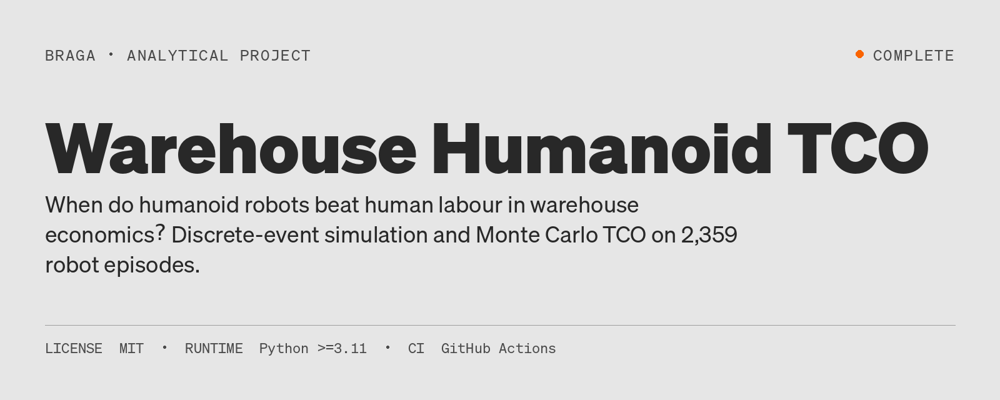
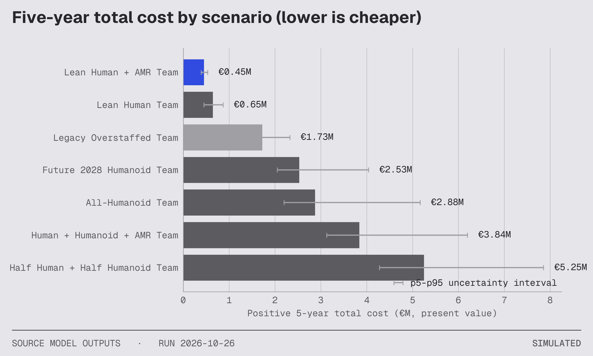
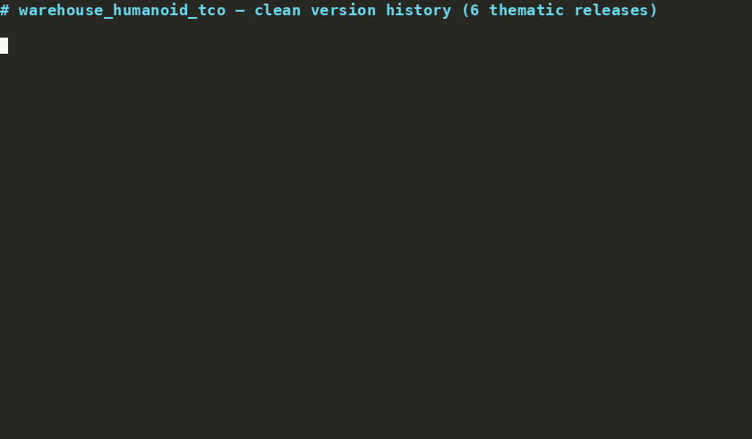
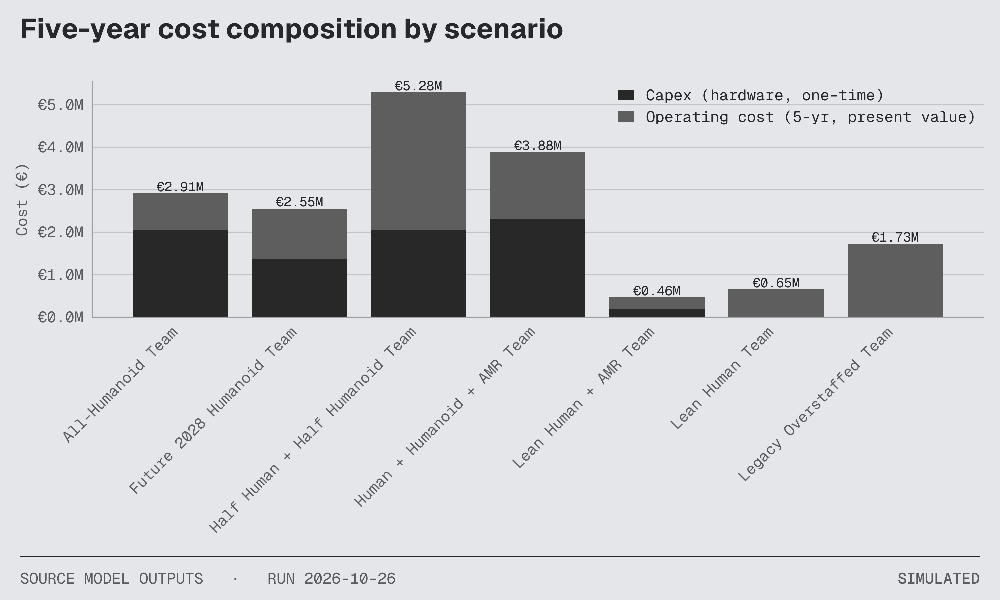
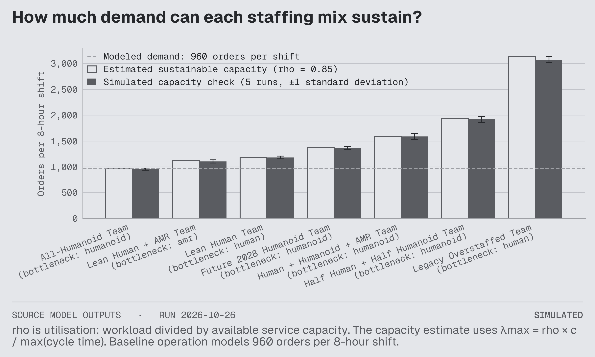
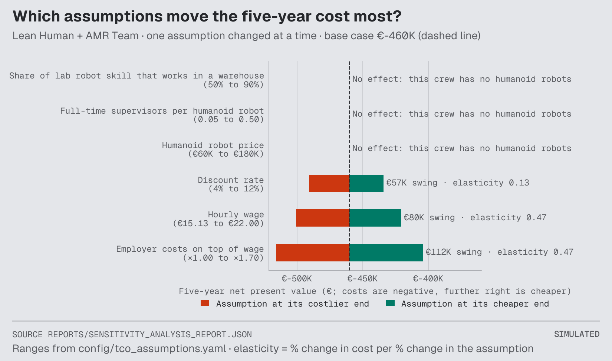
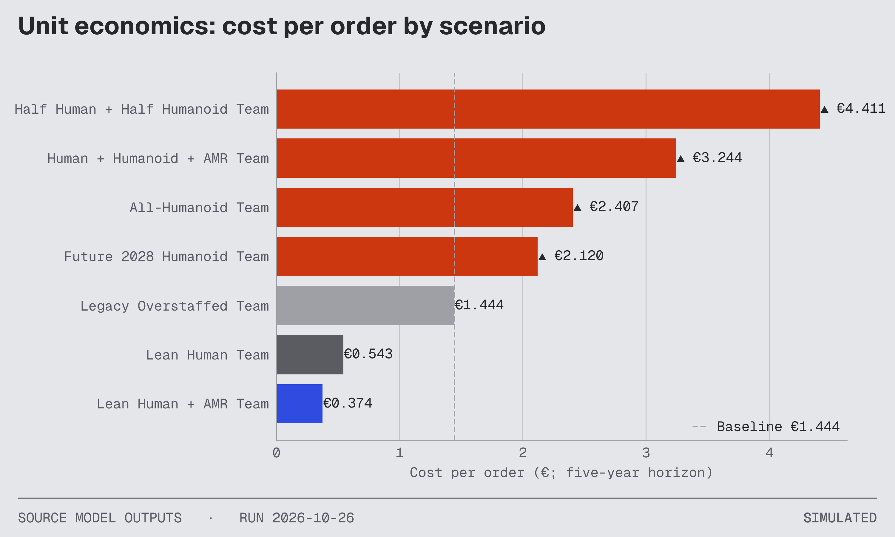
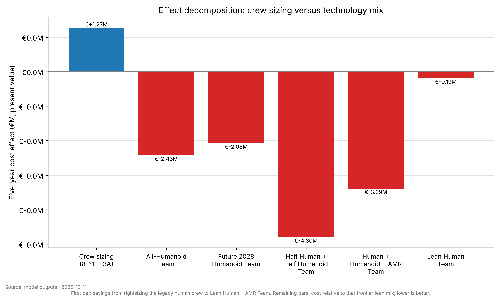
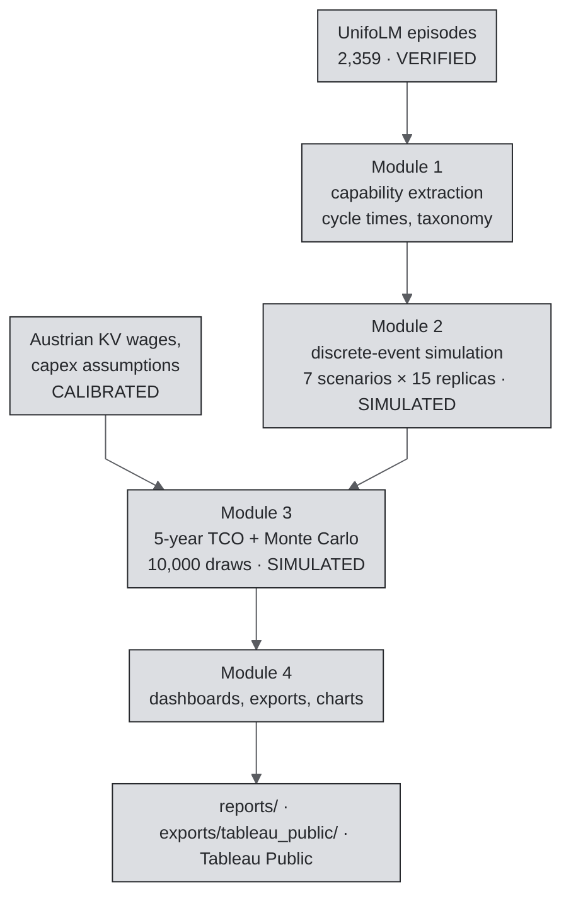

# Warehouse Humanoid TCO



[](https://github.com/RafaelBraga-Kribitz/warehouse_humanoid_tco/actions/workflows/ci.yml)
[](https://github.com/RafaelBraga-Kribitz/warehouse_humanoid_tco/actions/workflows/reproducibility.yml)
[](https://www.python.org/downloads/release/python-3110/)
[](LICENSE)
[](governance/AUDIT_PROCEDURE.md)
[](#status)

**Status:** Complete

When do humanoid robots beat human labor in warehouse economics? This project compares seven warehouse crews on five-year [total cost of ownership (TCO)](./docs/glossary.md#tco). It supports one decision: which crew to fund.

> - **Who decides:** the COO or site director of an Austrian AutoStore-class warehouse.
> - **What they choose:** where to put the capex (one-time hardware spend): humanoid robots, robot carts (AMRs, autonomous mobile robots), or workers only.
> - **The answer:** fund the lean mix of 1 worker and 3 robot carts. It costs €0.45M over five years in today's money. Today's 8-worker crew costs €1.73M. No humanoid crew costs less than today's crew. <!-- claim: reports/module_03_tco_report.json::scenario_results[4].npv_eur [eur_m]; claim: reports/module_03_tco_report.json::scenario_results[6].npv_eur [eur_m] -->
> - **The main caveat:** the robot speed data come from household tasks, not warehouse tasks. This is a modeled comparison, not a quote for one site. The lean mix has no humanoid robots, so it does not use the household speed factor.
> - **The chart:** [five-year total cost of seven crews](#what-the-numbers-say).

## Decision summary
### Decision statement and legend
> **Recommendation:** deploy Lean Human + AMR Team now (1 human + 3 AMRs) and defer humanoid procurement: no pure-humanoid capex in the searched €10,000–€500,000 range reaches parity with this frontier lean mix at 120 orders/hr — even near-free humanoids lose to 1H+3A, so capex is not the binding constraint; revisit under demand growth, labor scarcity, or multi-shift operation (see `reports/demand_frontier.json`). Integration cost and availability derating are modeled (F-222). <!-- claim: reports/module_03_tco_report.json::breakeven_thresholds.vs_lean_human.no_breakeven_in_search_range; claim: reports/module_03_tco_report.json::breakeven_thresholds.vs_lean_human.search_range_eur -->
> In Austrian intralogistics the practical automation driver is unfillable vacancies, not wage arbitrage; this model conservatively assumes labor is available at KV rates, so robot value is understated wherever vacancies go unfilled.

Legend: this is the decision statement as recorded in [PROJECT_CHARTER.md](./PROJECT_CHARTER.md). F-222 is the tracked finding on integration cost and availability derating (robots are not available all the time). 1H+3A means 1 worker + 3 robot carts. KV is the Austrian collective wage agreement (Kollektivvertrag).

### What the numbers say

At modeled demand, the lean mix is the cheapest crew that keeps every resource at or below 85 % workload. The 3-worker crew with no robots costs €0.65M (€647,401). It is the human-only comparison. Of the crews with humanoid robots, the 2028 humanoid crew costs least (€2.53M, or €2,532,753). It still costs more than today's 8-worker crew. That crew stays in the tables as a reference. It is overstaffed for this demand, so it is not a fair technology baseline. <!-- claim: reports/module_03_tco_report.json::scenario_results[5].npv_eur [eur_m]; claim: reports/module_03_tco_report.json::scenario_results[1].npv_eur [eur_m] -->



*Five-year cost of each crew in today's money. The highlighted lean mix costs €0.45M, against €1.73M for today's 8-worker crew. Every crew with humanoid robots costs more than today's crew. Grey whiskers show the 5th to 95th percentile range across 10,000 Monte Carlo draws. Labels round to €0.01M; the crew table gives exact euros. Chart labels: "Lean Human + AMR Team" is the lean mix, and "Legacy Overstaffed Team" is today's 8-worker crew.* <!-- claim: reports/module_03_tco_report.json::scenario_results[4].npv_eur [eur_m]; claim: reports/module_03_tco_report.json::scenario_results[6].npv_eur [eur_m] -->

## See it running



*`make all` runs the four pipeline stages (capability extraction, simulation, TCO, dashboards). It writes every chart and table on this page to `reports/` and `exports/`. Recording: [`docs/assets/demo.cast`](./docs/assets/demo.cast).*

Interactive view: [Tableau Public dashboard](https://public.tableau.com/app/profile/rafael.braga.kribitz/viz/HumanoidRoboticsTCO/Dashboard1), fed from the CSVs in [`exports/tableau_public/`](./exports/tableau_public/). SQL provenance for the CSVs is in [`analytics/sql/`](./analytics/sql/) (DuckDB; CI-tested parity).

## Explore this project

| Persona | Path |
|---------|------|
| **Recruiter (2 min)** | [DE PDF](./reports/Executive_Summary_DE.pdf) · [EN PDF](./reports/Executive_Summary_EN.pdf) · [Exhibit deck](./reports/exhibit_deck.pdf) · [Tableau Public](https://public.tableau.com/app/profile/rafael.braga.kribitz/viz/HumanoidRoboticsTCO/Dashboard1) · [60s walkthrough](./docs/walkthrough_60s.md) |
| **Hiring manager (10 min)** | [Decision box above](#decision-summary) · [EXPERIMENTS verdicts](./governance/EXPERIMENTS.md) · [data lineage](./docs/data_lineage.md) · [LIMITATIONS](./governance/LIMITATIONS.md) |
| **Auditor** | [governance/](./governance/README.md) · [AUDIT_STATE](./governance/AUDIT_STATE.json) · [QUALITY_BLUEPRINT](./governance/QUALITY_BLUEPRINT.md) |

## Results

### Five-year total cost of seven crews

The model uses a 5-year horizon and an 8 % discount rate a year. <!-- claim: reports/module_03_tco_report.json::discount_rate [pct] --> This page shows total cost as a positive number everywhere. Total cost is capex plus running cost, discounted to today's money, minus the robots' residual value at year 5.[^opex] In the last column, a plus sign is a cost increase and a minus sign is a saving. Lean Human + AMR Team is cheapest under the rule "max 85 % workload per resource". A robot cart (AMR) is a wheeled cart robot, not a humanoid with arms and legs. <!-- claim: structural -->

| Crew | Chart label | 5-year total cost, today's money (chart 1 label) | Capex | Running cost, 5 years (not discounted) | Cost per order | Cost change vs today's 8-worker crew |
| --- | --- | --- | --- | --- | --- | --- |
| **Lean mix: 1 worker + 3 robot carts** | Lean Human + AMR Team | **€452,706 (€0.45M)** | **€195K** | **€333,097** | **€0.374** | **-73.8 %** | <!-- claim: reports/module_03_tco_report.json::scenario_results[4].npv_eur [eur]; claim: reports/module_03_tco_report.json::scenario_results[4].total_capex_eur [eur]; claim: reports/module_03_tco_report.json::scenario_results[4].total_opex_5yr_eur_nominal [eur]; claim: reports/module_03_tco_report.json::scenario_results[4].cost_per_order_eur [eur]; claim: reports/module_03_tco_report.json::scenario_results[4].total_cost_reduction_vs_baseline_pct [pct] --> |
| 3 workers, no robots | Lean Human Team | €647,401 (€0.65M) | €0 | €813,811 | €0.543 | -62.5 % | <!-- claim: reports/module_03_tco_report.json::scenario_results[5].npv_eur [eur]; claim: reports/module_03_tco_report.json::scenario_results[5].total_capex_eur [eur]; claim: reports/module_03_tco_report.json::scenario_results[5].total_opex_5yr_eur_nominal [eur]; claim: reports/module_03_tco_report.json::scenario_results[5].cost_per_order_eur [eur]; claim: reports/module_03_tco_report.json::scenario_results[5].total_cost_reduction_vs_baseline_pct [pct] --> |
| Today's 8-worker crew (reference) | Legacy Overstaffed Team | €1,726,403 (€1.73M) | €0 | €2,170,163 | €1.444 | 0.0 % | <!-- claim: reports/module_03_tco_report.json::scenario_results[6].npv_eur [eur]; claim: reports/module_03_tco_report.json::scenario_results[6].total_capex_eur [eur]; claim: reports/module_03_tco_report.json::scenario_results[6].total_opex_5yr_eur_nominal [eur]; claim: reports/module_03_tco_report.json::scenario_results[6].cost_per_order_eur [eur]; claim: reports/module_03_tco_report.json::scenario_results[6].total_cost_reduction_vs_baseline_pct [pct] --> |
| 2028 humanoid crew: 3 workers + 9 humanoid robots (assumed faster in 2028) | Future 2028 Humanoid Team | €2,532,753 (€2.53M) | €1,365K | €1,491,506 | €2.120 | +46.7 % | <!-- claim: reports/module_03_tco_report.json::scenario_results[1].npv_eur [eur]; claim: reports/module_03_tco_report.json::scenario_results[1].total_capex_eur [eur]; claim: reports/module_03_tco_report.json::scenario_results[1].total_opex_5yr_eur_nominal [eur]; claim: reports/module_03_tco_report.json::scenario_results[1].cost_per_order_eur [eur]; claim: reports/module_03_tco_report.json::scenario_results[1].total_cost_reduction_vs_baseline_pct [pct] --> |
| 11 humanoid robots, no workers | All-Humanoid Team | €2,877,837 (€2.88M) | €2,052K | €1,076,782 | €2.407 | +66.7 % | <!-- claim: reports/module_03_tco_report.json::scenario_results[0].npv_eur [eur]; claim: reports/module_03_tco_report.json::scenario_results[0].total_capex_eur [eur]; claim: reports/module_03_tco_report.json::scenario_results[0].total_opex_5yr_eur_nominal [eur]; claim: reports/module_03_tco_report.json::scenario_results[0].cost_per_order_eur [eur]; claim: reports/module_03_tco_report.json::scenario_results[0].total_cost_reduction_vs_baseline_pct [pct] --> |
| 3 workers + 11 humanoid robots + 4 robot carts | Human + Humanoid + AMR Team | €3,841,113 (€3.84M) | €2,312K | €1,973,029 | €3.244 | +122.5 % | <!-- claim: reports/module_03_tco_report.json::scenario_results[3].npv_eur [eur]; claim: reports/module_03_tco_report.json::scenario_results[3].total_capex_eur [eur]; claim: reports/module_03_tco_report.json::scenario_results[3].total_opex_5yr_eur_nominal [eur]; claim: reports/module_03_tco_report.json::scenario_results[3].cost_per_order_eur [eur]; claim: reports/module_03_tco_report.json::scenario_results[3].total_cost_reduction_vs_baseline_pct [pct] --> |
| 11 workers + 11 humanoid robots | Half Human + Half Humanoid Team | €5,251,641 (€5.25M) | €2,052K | €4,060,757 | €4.411 | +204.2 % | <!-- claim: reports/module_03_tco_report.json::scenario_results[2].npv_eur [eur]; claim: reports/module_03_tco_report.json::scenario_results[2].total_capex_eur [eur]; claim: reports/module_03_tco_report.json::scenario_results[2].total_opex_5yr_eur_nominal [eur]; claim: reports/module_03_tco_report.json::scenario_results[2].cost_per_order_eur [eur]; claim: reports/module_03_tco_report.json::scenario_results[2].total_cost_reduction_vs_baseline_pct [pct] --> |

[^opex]: Running-cost-only percentages in the Tableau CSVs ignore capex. A pure-humanoid crew can look strong on running cost while its total cost rises. <!-- claim: structural -->

### The lean mix is cheapest in 99.8 % of 10,000 Monte Carlo draws

A Monte Carlo draw re-runs the model with the inputs varied inside their ranges. The model ran 10,000 draws for each of the 7 crews. The lean mix is cheapest in 99.8 % of draws. Its mean five-year cost is €461,414 (±€43,755, one standard deviation). The median is €458,769. The 90 % output interval (5th to 95th percentile) runs from €394,658 to €537,549. The sensitivity report gives the expected value of perfect information (`evpi_eur`) for each input. It shows which uncertainty is worth measuring before procurement. For the lean mix, it is about €0 for every input. <!-- claim: reports/sensitivity_analysis_report.json::mc_summary.npv_mean [eur]; claim: reports/sensitivity_analysis_report.json::mc_summary.npv_std [eur]; claim: reports/sensitivity_analysis_report.json::mc_summary.npv_p50 [eur]; claim: reports/sensitivity_analysis_report.json::mc_summary.npv_p5 [eur]; claim: reports/sensitivity_analysis_report.json::mc_summary.npv_p95 [eur]; claim: reports/sensitivity_analysis_report.json::evpi_eur -->

### What moves the cost most

Employer costs on top of wage (×1.00 to ×1.70) swing the lean mix cost by €112K. Hourly wage (€15.13 to €22.00) swings it by €80K. The discount rate (4 % to 12 %) swings it by €57K. Humanoid robot price, supervisors per humanoid robot and the speed transfer factor have no effect, because the lean mix has no humanoid robots. <!-- claim: reports/sensitivity_analysis_report.json::oat_elasticity_ranking -->

| Chart | View | How to read it |
|-------|------|----------------|
| 2. Cost stack |  | Capex plus running cost in today's money, before the robots' residual value at year 5. Totals run a little higher than chart 1: €0.46M against €0.45M for the lean mix. The gap is the residual value (€7,465 in today's money). <!-- claim: reports/module_03_tco_report.json::scenario_results[4].residual_salvage_eur --> |
| 3. Capacity |  | Orders per 8-hour shift. The dashed line is demand: 960 orders per shift, or 120 per hour. "Bottleneck" names the resource type that limits capacity. "rho" is workload (utilisation). The simulated check uses 5 runs per crew. |
| 4. What moves the cost most |  | This chart shows cost as a negative number, so further right is cheaper. Its base case is €460K (shown as €-460K), the cost before the robots' residual value. It is €7K above the table value. <!-- claim: reports/sensitivity_analysis_report.json::oat_elasticity_ranking --> |
| 5. Cost per order |  | Cost per order in €. The dashed line (€1.444) is today's 8-worker crew. Red bars cost more than that line. <!-- claim: reports/module_03_tco_report.json::scenario_results[6].cost_per_order_eur --> |
| 6. Saving from right-sizing, and extra cost of each humanoid crew |  | This chart shows a saving as positive and an extra cost as negative. That is the reverse of the cost sign on this page. First bar: the move from today's 8-worker crew to the lean mix saves €1.27M. Other bars: extra cost against the lean mix. "1H+3A" means 1 worker + 3 robot carts. <!-- claim: reports/module_03_tco_report.json::scenario_results[6].npv_eur [eur_m] --> |

## Known limits

- This ranking is a modeled comparison, not a procurement case for one site. It does not establish warehouse-native cycle times, signed humanoid quotes, or vacancy-driven labor scarcity.
- Public pricing and estimated KV wages can move the total cost in either direction. Full table: [`governance/LIMITATIONS.md`](./governance/LIMITATIONS.md).
- Reproducibility here means the documented pipeline and a weekly CI determinism check ([`reproducibility.yml`](./.github/workflows/reproducibility.yml)). An AI coding agent ran the committed [reproduction log](./governance/REPRODUCTION_LOG.md). No third party has repeated the run from a fresh clone. The Tableau workbook and the demo GIF show the interface; they are not production telemetry.

#### External validity — what the source data is and is not

The source data are household demonstrations: plates-into-dishwasher, pillow pickup, clothes-into-washing-machine, and dual-arm and single-arm DiverseManip tasks. No source episode is a warehouse task. The analysis uses pick-move-place primitives as a proxy. It applies a 0.50–0.90 transfer factor for speed. So domain-transfer risk is the largest external-validity threat. Warehouse-native task telemetry would falsify or repair this proxy. It would replace the household cycle-time evidence.

## What I would do with production data

Replace the household transfer proxy with local pick-move-place telemetry. Measure integration effort and availability on the actual grid. Re-run the demand frontier with the observed order mix and unfilled vacancies. Use client wage tables and contracted capex in place of public KV estimates and list prices. Until those inputs exist, the recommendation depends on the documented assumptions. It is not a client business case.

## Why this project

I live 20 minutes from Knapp AG's headquarters. I wanted to understand what operations analysts there evaluate when they look at humanoid robot integration in 2026. I did not want the hype cycle. I wanted the unit economics. The biggest surprise: the sensitivity analysis depends more on headcount assumptions than on robot capex. Say you have 8 workers and replace 1.6 of them with 1.6 humanoid robots. The labor saving then depends almost entirely on how many full-time workers you need. It does not depend on whether a robot costs €100K or €180K. <!-- claim: structural -->

The second surprise: cycle time varies 3× across task categories in the real UnifoLM data. Pick tasks are far noisier than place tasks. This makes the advantage of the robot-cart mix fragile in some scenarios. With more time, I would calibrate against actual Knapp throughput benchmarks instead of public estimates. I would also add a learning curve for humanoid performance over the first 12 months of deployment.

## Data

- **2,359 episodes** from 5 UnifoLM datasets. Cycle time feeds the simulation. <!-- claim: reports/module_01_capability_extraction_report.json::total_episodes_extracted [count] -->
- **The multi-label taxonomy** is rule-based ([taxonomy rules](./docs/taxonomy_rules.md)). `success_rate=1.0` holds by construction. It measures demo completion, not reliability.
- **Provenance and sources:** [`reports/derisk_inspection_report.json`](./reports/derisk_inspection_report.json) · notebook [01_data_profile_summary.ipynb](./notebooks/01_data_profile_summary.ipynb). [`governance/DATA_SOURCES.md`](./governance/DATA_SOURCES.md) lists every dataset (with its pinned Hugging Face revision) and every wage and cost source. [`governance/CITATION_AUDIT.md`](./governance/CITATION_AUDIT.md) grades how far each public source supports the exact number used. [`governance/ASSUMPTION_REGISTER.md`](./governance/ASSUMPTION_REGISTER.md) lists every cost assumption with its range.
- **Epistemic tags:** `VERIFIED` marks episode counts and SHA-pinned UnifoLM sources. `CALIBRATED` marks the household-to-warehouse transfer factor and the Austrian KV wage inputs. `SIMULATED` marks the discrete-event warehouse runs and the Monte Carlo cost. `ILLUSTRATIVE` marks the demo GIF and the Tableau workbook.

## How it works

### Simulation

The model ran 15 replicas for each of 7 crews (105 runs). Throughput follows demand at 120 orders per hour. Capacity ceilings run from 970 to 3,133 orders per shift at 85 % workload (rho = 0.85). Rho, or utilisation, is the share of time a worker or robot is busy. Service time per order scales with the pick lines in the order ([decision record](./governance/adrs/0017-pick-lines-order-service-time.md)). The model sizes each crew to the workload rule before it compares technologies ([decision record](./governance/adrs/0014-fair-scenario-redesign.md)). The [demand frontier](./reports/demand_frontier.json) then publishes the lean mix as the cheapest feasible crew. Cost uses a discount rate of 8 % a year over five years. The model ranks crews by total cost, not by running cost alone. Hypotheses and their verdicts are in [`governance/EXPERIMENTS.md`](./governance/EXPERIMENTS.md).

## How it fits together



Entry points: `make module-01` to `make module-04` call `warehouse_humanoid_tco.pipelines.module_0N_*`. `make all` runs them in order. Governance artifacts (findings, decision records, audit state) are in [`governance/`](./governance/).

## Quick start

```bash
git clone https://github.com/RafaelBraga-Kribitz/warehouse_humanoid_tco.git && cd warehouse_humanoid_tco
git lfs install && git lfs pull   # required — without LFS, Module 1 fails closed (0 episodes)
uv venv .venv && source .venv/bin/activate && uv pip install -e ".[dev]"
make all
```

Without `uv`: `pip install -r requirements.txt`.

## How this was built

AI coding agents develop this repository under a protocol that a human designed and CI enforces. Every change closes a tracked finding with a named verification script. CI re-runs the script of every closed finding on every pull request. The protocol, its failure-mode taxonomy and its full audit history are public in [governance/](./governance/). The single source of truth (SSOT) for scope is [PROJECT_CHARTER.md](./PROJECT_CHARTER.md). The methodology decision records are in [governance/adrs/](./governance/adrs/).

## Repository structure

```text
analytics/                  18 files
config/                     6 files
data/                       48 files
docker/                     2 files
docs/                       20 files
examples/                   2 files
exports/                    5 files
governance/                 136 files
notebooks/                  5 files
reports/                    39 files
scripts/                    52 files
src/                        33 files
tests/                      87 files
CHANGELOG.md
CITATION.cff
```

## Status

**Status:** Complete

Repository last updated 2026-10-26 (date of the last commit).

## Author

<table>
  <tr>
    <td width="110">
      
    </td>
    <td>
      <strong>Rafael Braga-Kribitz</strong><br />
      Seiersberg-Pirka, Austria · Portfolio project, 2026<br />
      <a href="https://www.linkedin.com/in/rafaelbragakribitz/">LinkedIn</a>
      ·
      <a href="mailto:rafaelbragakribitz@gmail.com">rafaelbragakribitz@gmail.com</a>
    </td>
  </tr>
</table>

## License

[MIT](./LICENSE)
