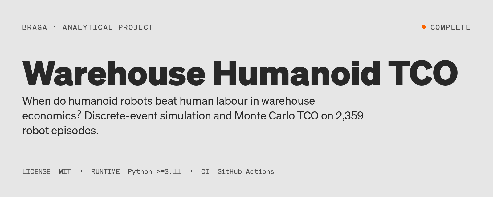
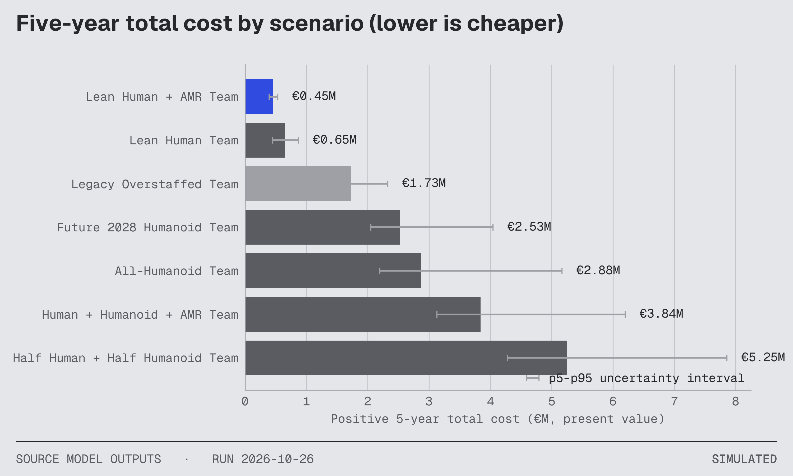
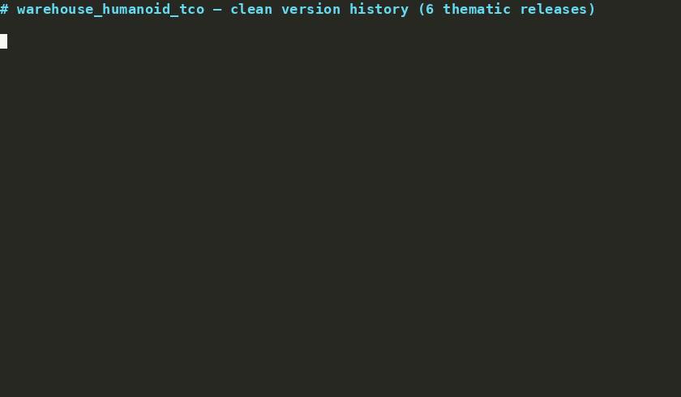
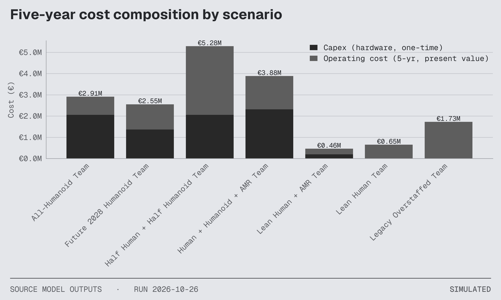
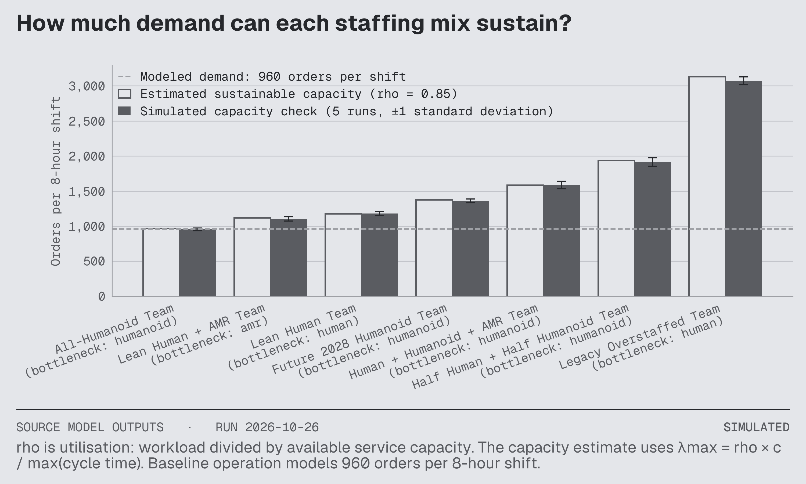
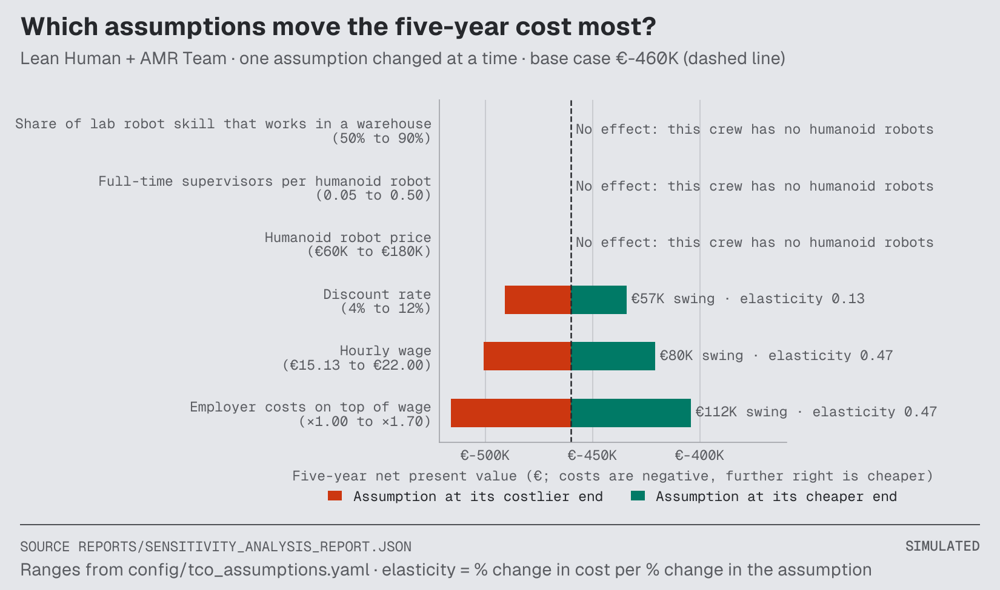
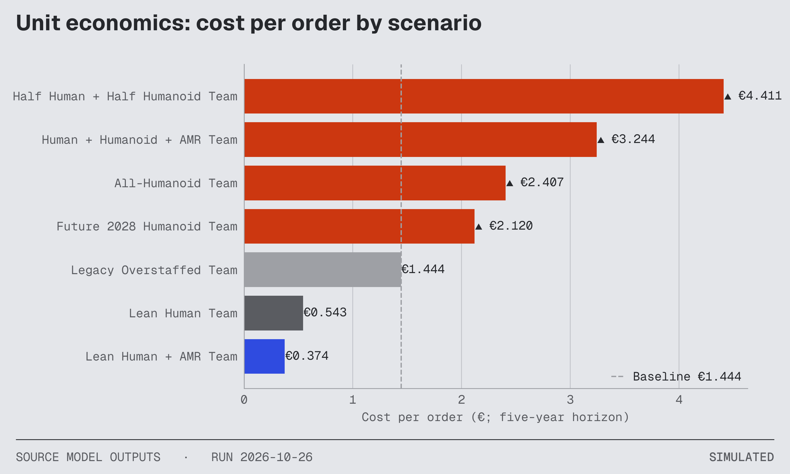
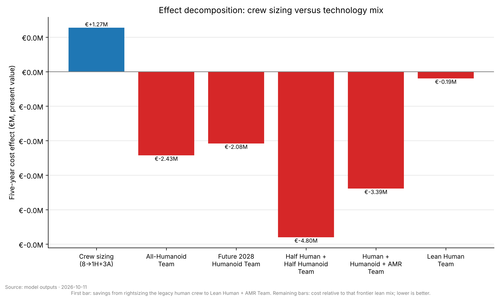
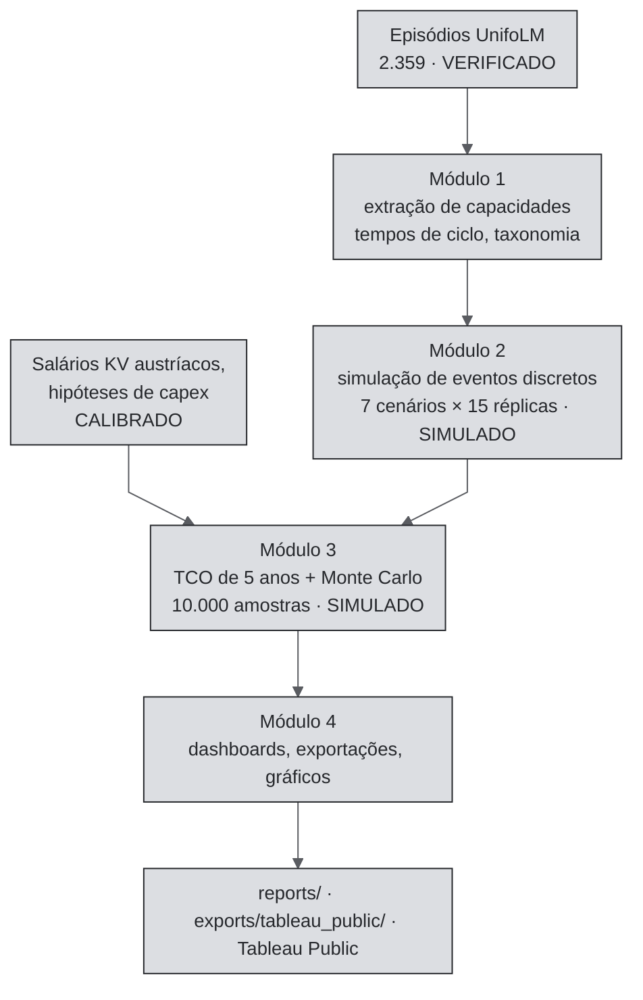

[🇧🇷 PT-BR](README.pt-BR.md) · [🇬🇧 EN-UK](README.md) · [🇦🇹 DE-AT](README.de-AT.md)

# TCO de robôs humanoides em armazéns



[](https://github.com/RafaelBraga-Kribitz/warehouse_humanoid_tco/actions/workflows/ci.yml)
[](https://github.com/RafaelBraga-Kribitz/warehouse_humanoid_tco/actions/workflows/reproducibility.yml)
[](https://www.python.org/downloads/release/python-3110/)
[](LICENSE)
[](governance/AUDIT_PROCEDURE.md)
[](#status)

**Status:** Concluído

Em que condições robôs humanoides superam o trabalho humano na economia de armazéns? Este projeto compara sete equipes de armazém pelo [custo total de propriedade (TCO)](./docs/glossary.md#tco) em cinco anos. Ele apoia uma decisão: qual equipe financiar.

> - **Quem decide:** o COO ou diretor de unidade de um armazém austríaco de classe AutoStore.
> - **O que escolhe:** onde investir o capex (desembolso único em equipamentos): robôs humanoides, carrinhos robóticos (AMRs, robôs móveis autônomos) ou apenas trabalhadores.
> - **Resposta:** financiar a combinação enxuta de 1 trabalhador e 3 carrinhos robóticos. Em valores presentes, ela custa €0,45 milhão em cinco anos, contra €0,65 milhão na comparação justa, a equipe de 3 trabalhadores. A economia modelada é de cerca de €0,195 milhão (€194.695). A referência legada modelada com 8 trabalhadores custa €1,73 milhão. Nenhuma equipe com humanoides custa menos que essa referência. <!-- claim: reports/module_03_tco_report.json::scenario_results[4].npv_eur [eur_m]; claim: reports/module_03_tco_report.json::scenario_results[5].npv_eur [eur_m]; claim: reports/module_03_tco_report.json::scenario_results[6].npv_eur [eur_m] -->
> - **Principal ressalva:** os dados de velocidade dos robôs vêm de tarefas domésticas, não de tarefas de armazém. Trata-se de uma comparação modelada, não de uma cotação para uma unidade específica. A combinação enxuta não tem robôs humanoides; portanto, não usa o fator de velocidade doméstica.
> - **Gráfico:** [custo total em cinco anos para sete equipes](#o-que-os-números-dizem).

## Resumo da decisão

### Declaração da decisão e legenda

> **Recomendação:** implantar agora a equipe enxuta de pessoas + AMRs (1 pessoa + 3 AMRs) e adiar a compra de humanoides: com demanda de 120 pedidos/hora, nenhum capex para uma equipe exclusivamente humanoide na faixa pesquisada de €10.000 a €500.000 alcança o custo da combinação enxuta de referência — mesmo humanoides quase gratuitos perdem para 1 pessoa + 3 AMRs; portanto, o capex não é a restrição determinante. Reavaliar quando houver crescimento da demanda, escassez de mão de obra ou operação em vários turnos (ver `reports/demand_frontier.json`). O custo de integração e a redução por indisponibilidade estão modelados (F-222). <!-- claim: reports/module_03_tco_report.json::breakeven_thresholds.vs_lean_human.no_breakeven_in_search_range; claim: reports/module_03_tco_report.json::breakeven_thresholds.vs_lean_human.search_range_eur -->
> Na intralogística austríaca, o fator prático para automatizar são vagas que não podem ser preenchidas, e não a arbitragem salarial. Este modelo assume de forma conservadora que a mão de obra está disponível pelos valores dos Kollektivvertrag (KV, acordos coletivos), portanto subestima o valor dos robôs onde as vagas ficam abertas.

Legenda: esta é a declaração da decisão registrada em [PROJECT_CHARTER.md](./PROJECT_CHARTER.md). F-222 é o achado acompanhado sobre custo de integração e redução por disponibilidade (robôs não estão disponíveis o tempo todo). 1H+3A significa 1 trabalhador + 3 carrinhos robóticos. KV é o acordo coletivo salarial austríaco (Kollektivvertrag).

### O que os números dizem

Na demanda modelada, a combinação enxuta é a equipe de menor custo que mantém cada recurso em carga de trabalho igual ou inferior a 85%. A equipe de 3 trabalhadores sem robôs custa €0,65 milhão (€647.401). Esta é a comparação apenas com mão de obra humana. Entre as equipes com robôs humanoides, a equipe humanoide de 2028 é a mais barata (€2,53 milhões, ou €2.532.753). Ainda assim, custa mais que a referência legada de 8 trabalhadores. Essa referência é uma equipe superdimensionada modelada. Nenhuma fonte mostra uma unidade real com 8 trabalhadores. Ela não é uma base tecnológica justa; por isso, a comparação justa é a equipe de 3 trabalhadores. <!-- claim: reports/module_03_tco_report.json::scenario_results[5].npv_eur [eur_m]; claim: reports/module_03_tco_report.json::scenario_results[1].npv_eur [eur_m] -->



*Custo de cada equipe em cinco anos, em valores presentes. A combinação enxuta destacada custa €0,45 milhão, contra €1,73 milhão para a referência legada modelada de 8 trabalhadores. Todas as equipes com humanoides custam mais que a referência legada. As barras de erro cinza mostram o intervalo do 5º ao 95º percentil em 10.000 amostras de Monte Carlo. Os rótulos arredondam para €0,01 milhão; a tabela de equipes mostra os valores exatos em euros. Nos rótulos do gráfico, “Lean Human + AMR Team” é a combinação enxuta e “Legacy Overstaffed Team” é a referência legada de 8 trabalhadores.* <!-- claim: reports/module_03_tco_report.json::scenario_results[4].npv_eur [eur_m]; claim: reports/module_03_tco_report.json::scenario_results[6].npv_eur [eur_m] -->

## Por que este projeto existe

Operadores de armazéns austríacos recebem ofertas de robôs humanoides baseadas em demonstrações de fornecedores e também precisam dimensionar as equipes que fazem a separação de pedidos ao lado deles. Este projeto deveria ajudar um COO a decidir quantos separadores uma célula AutoStore precisa e se deve testar dois humanoides ou esperar. A avaliação anterior à construção estimou €53 mil em valor decisório contra um custo central de €11.124. Isso equivale a 4,8× e passa, por margem estreita, o requisito financeiro de 4×. Resultado observado: ainda não medido; nenhuma decisão de operador foi registrada. Detalhes: [avaliação econômica](docs/economic-evaluation.md). <!-- claim: structural -->

## Veja em execução



*`make all` executa as quatro etapas da pipeline (extração de capacidades, simulação, TCO e dashboards). Ela grava todos os gráficos e tabelas desta página em `reports/` e `exports/`. Gravação: [`docs/assets/demo.cast`](./docs/assets/demo.cast).*

Visualização interativa: [dashboard no Tableau Public](https://public.tableau.com/app/profile/rafael.braga.kribitz/viz/HumanoidRoboticsTCO/Dashboard1), alimentado pelos CSVs em [`exports/tableau_public/`](./exports/tableau_public/). A procedência SQL dos CSVs está em [`analytics/sql/`](./analytics/sql/) (DuckDB; paridade verificada por CI).

## Explore este projeto

| Perfil | Percurso |
|---------|------|
| **Recrutador (2 min)** | [PDF em alemão](./reports/Executive_Summary_DE.pdf) · [PDF em inglês](./reports/Executive_Summary_EN.pdf) · [Apresentação](./reports/exhibit_deck.pdf) · [Tableau Public](https://public.tableau.com/app/profile/rafael.braga.kribitz/viz/HumanoidRoboticsTCO/Dashboard1) · [Apresentação de 60 s](./docs/walkthrough_60s.md) |
| **Gestor de contratação (10 min)** | [Quadro de decisão acima](#resumo-da-decisão) · [Conclusões dos EXPERIMENTOS](./governance/EXPERIMENTS.md) · [linhagem dos dados](./docs/data_lineage.md) · [LIMITAÇÕES](./governance/LIMITATIONS.md) |
| **Auditor** | [governança](./governance/README.md) · [AUDIT_STATE](./governance/AUDIT_STATE.json) · [QUALITY_BLUEPRINT](./governance/QUALITY_BLUEPRINT.md) |

## Resultados

### Custo total em cinco anos para sete equipes

O modelo usa um horizonte de cinco anos e taxa de desconto anual de 8%. <!-- claim: reports/module_03_tco_report.json::discount_rate [pct] --> Esta página apresenta os custos totais como valores positivos. O custo total é capex mais custo operacional, descontados a valor presente, menos o valor residual dos robôs no quinto ano.[^opex] Na última coluna, um sinal positivo indica aumento de custo e um sinal negativo indica economia. A equipe enxuta de pessoas + AMRs é a mais barata sob a regra “carga máxima de 85% por recurso”. Um carrinho robótico (AMR) é um robô com rodas, não um humanoide com braços e pernas. <!-- claim: structural -->

| Equipe | Rótulo do gráfico | Custo total em 5 anos, valor presente (rótulo do gráfico 1) | Capex | Custo operacional em 5 anos (não descontado) | Custo por pedido | Variação frente à referência legada de 8 trabalhadores |
| --- | --- | --- | --- | --- | --- | --- |
| **Combinação enxuta: 1 trabalhador + 3 carrinhos robóticos** | Lean Human + AMR Team | **€452.706 (€0,45 mi)** | **€195 mil** | **€333.097** | **€0,374** | **-73,8%** | <!-- claim: reports/module_03_tco_report.json::scenario_results[4].npv_eur [eur]; claim: reports/module_03_tco_report.json::scenario_results[4].total_capex_eur [eur]; claim: reports/module_03_tco_report.json::scenario_results[4].total_opex_5yr_eur_nominal [eur]; claim: reports/module_03_tco_report.json::scenario_results[4].cost_per_order_eur [eur]; claim: reports/module_03_tco_report.json::scenario_results[4].total_cost_reduction_vs_baseline_pct [pct] -->
| 3 trabalhadores, sem robôs | Lean Human Team | €647.401 (€0,65 mi) | €0 | €813.811 | €0,543 | -62,5% | <!-- claim: reports/module_03_tco_report.json::scenario_results[5].npv_eur [eur]; claim: reports/module_03_tco_report.json::scenario_results[5].total_capex_eur [eur]; claim: reports/module_03_tco_report.json::scenario_results[5].total_opex_5yr_eur_nominal [eur]; claim: reports/module_03_tco_report.json::scenario_results[5].cost_per_order_eur [eur]; claim: reports/module_03_tco_report.json::scenario_results[5].total_cost_reduction_vs_baseline_pct [pct] -->
| Referência legada modelada de 8 trabalhadores | Legacy Overstaffed Team | €1.726.403 (€1,73 mi) | €0 | €2.170.163 | €1,444 | 0,0% | <!-- claim: reports/module_03_tco_report.json::scenario_results[6].npv_eur [eur]; claim: reports/module_03_tco_report.json::scenario_results[6].total_capex_eur [eur]; claim: reports/module_03_tco_report.json::scenario_results[6].total_opex_5yr_eur_nominal [eur]; claim: reports/module_03_tco_report.json::scenario_results[6].cost_per_order_eur [eur]; claim: reports/module_03_tco_report.json::scenario_results[6].total_cost_reduction_vs_baseline_pct [pct] -->
| Equipe humanoide de 2028: 3 trabalhadores + 9 humanoides (velocidade maior presumida para 2028) | Future 2028 Humanoid Team | €2.532.753 (€2,53 mi) | €1.365 mil | €1.491.506 | €2,120 | +46,7% | <!-- claim: reports/module_03_tco_report.json::scenario_results[1].npv_eur [eur]; claim: reports/module_03_tco_report.json::scenario_results[1].total_capex_eur [eur]; claim: reports/module_03_tco_report.json::scenario_results[1].total_opex_5yr_eur_nominal [eur]; claim: reports/module_03_tco_report.json::scenario_results[1].cost_per_order_eur [eur]; claim: reports/module_03_tco_report.json::scenario_results[1].total_cost_reduction_vs_baseline_pct [pct] -->
| 11 humanoides, sem trabalhadores | All-Humanoid Team | €2.877.837 (€2,88 mi) | €2.052 mil | €1.076.782 | €2,407 | +66,7% | <!-- claim: reports/module_03_tco_report.json::scenario_results[0].npv_eur [eur]; claim: reports/module_03_tco_report.json::scenario_results[0].total_capex_eur [eur]; claim: reports/module_03_tco_report.json::scenario_results[0].total_opex_5yr_eur_nominal [eur]; claim: reports/module_03_tco_report.json::scenario_results[0].cost_per_order_eur [eur]; claim: reports/module_03_tco_report.json::scenario_results[0].total_cost_reduction_vs_baseline_pct [pct] -->
| 3 trabalhadores + 11 humanoides + 4 carrinhos robóticos | Human + Humanoid + AMR Team | €3.841.113 (€3,84 mi) | €2.312 mil | €1.973.029 | €3,244 | +122,5% | <!-- claim: reports/module_03_tco_report.json::scenario_results[3].npv_eur [eur]; claim: reports/module_03_tco_report.json::scenario_results[3].total_capex_eur [eur]; claim: reports/module_03_tco_report.json::scenario_results[3].total_opex_5yr_eur_nominal [eur]; claim: reports/module_03_tco_report.json::scenario_results[3].cost_per_order_eur [eur]; claim: reports/module_03_tco_report.json::scenario_results[3].total_cost_reduction_vs_baseline_pct [pct] -->
| 11 trabalhadores + 11 humanoides | Half Human + Half Humanoid Team | €5.251.641 (€5,25 mi) | €2.052 mil | €4.060.757 | €4,411 | +204,2% | <!-- claim: reports/module_03_tco_report.json::scenario_results[2].npv_eur [eur]; claim: reports/module_03_tco_report.json::scenario_results[2].total_capex_eur [eur]; claim: reports/module_03_tco_report.json::scenario_results[2].total_opex_5yr_eur_nominal [eur]; claim: reports/module_03_tco_report.json::scenario_results[2].cost_per_order_eur [eur]; claim: reports/module_03_tco_report.json::scenario_results[2].total_cost_reduction_vs_baseline_pct [pct] -->

[^opex]: As percentagens que consideram apenas custos operacionais nos CSVs do Tableau ignoram capex. Uma equipe exclusivamente humanoide pode parecer eficiente nos custos operacionais enquanto o custo total aumenta. <!-- claim: structural -->

### A combinação enxuta é a mais barata em 99,8% de 10.000 amostras de Monte Carlo

Uma amostra de Monte Carlo executa novamente o modelo com entradas variadas dentro de suas faixas. O modelo executou 10.000 amostras para cada uma das 7 equipes. A combinação enxuta é a mais barata em 99,8% das amostras. Seu custo médio em cinco anos é €461.414 (±€43.755, um desvio-padrão). A mediana é €458.769. O intervalo de 90% dos resultados (5º ao 95º percentil) vai de €394.658 a €537.549. O relatório de sensibilidade fornece o valor esperado da informação perfeita (`evpi_eur`) para cada entrada. Ele indica quais incertezas valeria a pena medir antes da compra. Para a combinação enxuta, esse valor é aproximadamente €0 para todas as entradas. <!-- claim: reports/sensitivity_analysis_report.json::mc_summary.npv_mean [eur]; claim: reports/sensitivity_analysis_report.json::mc_summary.npv_std [eur]; claim: reports/sensitivity_analysis_report.json::mc_summary.npv_p50 [eur]; claim: reports/sensitivity_analysis_report.json::mc_summary.npv_p5 [eur]; claim: reports/sensitivity_analysis_report.json::mc_summary.npv_p95 [eur]; claim: reports/sensitivity_analysis_report.json::evpi_eur -->

### O que mais altera o custo

Os encargos patronais além do salário (×1,00 a ×1,70) alteram o custo da combinação enxuta em €112 mil. O salário por hora (€15,13 a €22,00) altera-o em €80 mil. A taxa de desconto (4% a 12%) altera-o em €57 mil. O preço dos humanoides, o número de supervisores por humanoide e o fator de transferência de velocidade não têm efeito, pois a combinação enxuta não inclui humanoides. <!-- claim: reports/sensitivity_analysis_report.json::oat_elasticity_ranking -->

| Gráfico | Visualização | Como interpretar |
|-------|------|----------------|
| 2. Composição de custos |  | Capex mais custo operacional em valores presentes, antes do valor residual dos robôs no ano 5. Os totais ficam ligeiramente acima do gráfico 1: €0,46 milhão contra €0,45 milhão da combinação enxuta. A diferença é o valor residual (€7.465 em valor presente). <!-- claim: reports/module_03_tco_report.json::scenario_results[4].residual_salvage_eur --> |
| 3. Capacidade |  | Pedidos por turno de 8 horas. A linha tracejada representa a demanda: 960 pedidos por turno, ou 120 por hora. “Bottleneck” identifica o tipo de recurso que limita a capacidade. “rho” é a carga de trabalho (utilização). A verificação simulada usa 5 execuções por equipe. |
| 4. O que mais altera o custo |  | Este gráfico representa o custo como número negativo; portanto, quanto mais à direita, menor o custo. O caso-base é €460 mil (mostrado como €-460 mil), antes do valor residual dos robôs. É €7 mil acima do valor da tabela. <!-- claim: reports/sensitivity_analysis_report.json::oat_elasticity_ranking --> |
| 5. Custo por pedido |  | Custo por pedido em euros. A linha tracejada (€1,444) representa a referência legada de 8 trabalhadores. Barras vermelhas indicam custo acima dessa linha. <!-- claim: reports/module_03_tco_report.json::scenario_results[6].cost_per_order_eur --> |
| 6. Economia com dimensionamento correto e custo adicional de cada equipe humanoide |  | Este gráfico mostra economias como valores positivos e custos adicionais como negativos, o inverso da convenção de sinais usada nesta página. A primeira barra: passar da referência legada de 8 trabalhadores para a combinação enxuta economiza €1,27 milhão no modelo. É resultado modelado, não economia observada. As outras barras mostram custos adicionais em relação à combinação enxuta. “1H+3A” significa 1 trabalhador + 3 carrinhos robóticos. <!-- claim: reports/module_03_tco_report.json::scenario_results[6].npv_eur [eur_m] --> |

## Limitações conhecidas

- Esta classificação é uma comparação modelada, não um caso de compra para uma unidade específica. Ela não estabelece tempos de ciclo próprios de armazéns, cotações firmes de humanoides ou escassez de mão de obra causada por vagas não preenchidas.
- Preços públicos e salários KV estimados podem alterar o custo total para qualquer direção. Tabela completa: [`governance/LIMITATIONS.md`](./governance/LIMITATIONS.md).
- Aqui, reprodutibilidade significa a pipeline documentada e uma verificação semanal de determinismo no CI ([`reproducibility.yml`](./.github/workflows/reproducibility.yml)). Um agente de programação com IA executou o [registro de reprodução](./governance/REPRODUCTION_LOG.md) versionado. Nenhum terceiro repetiu a execução a partir de um clone limpo. A pasta de trabalho do Tableau e o GIF de demonstração mostram a interface; não são telemetria de produção.

#### Validade externa — o que os dados-fonte são e o que não são

Os dados-fonte são demonstrações domésticas: colocar pratos na máquina de lavar, pegar um travesseiro, colocar roupas na máquina de lavar e tarefas DiverseManip com dois braços e com um braço. Nenhum episódio de origem é uma tarefa de armazém. A análise usa ações elementares de pegar-mover-colocar como proxy. Aplica um fator de transferência de velocidade de 0,50 a 0,90. Portanto, o risco de transferência entre domínios é a maior ameaça à validade externa. Telemetria de tarefas reais de armazém poderia refutar ou corrigir esse proxy e substituir as evidências de tempo de ciclo doméstico.

## O que eu faria com dados de produção

Substituiria o proxy transferido de tarefas domésticas por telemetria local de pegar-mover-colocar. Mediria o esforço de integração e a disponibilidade na operação real. Reexecutaria a fronteira de demanda usando o mix de pedidos observado e as vagas não preenchidas. Usaria tabelas salariais do cliente e capex contratado em vez de estimativas KV públicas e preços de lista. Até que esses dados existam, a recomendação depende das hipóteses documentadas. Não é um caso de negócio para um cliente.

## Por que este projeto

Moro a 20 minutos da sede da Knapp AG. Queria entender o que analistas de operações avaliam quando consideram a integração de robôs humanoides em 2026. Não queria acompanhar o ciclo de hype; queria entender a economia unitária. A maior surpresa: a análise de sensibilidade depende mais das hipóteses de dimensionamento da equipe do que do capex dos robôs. Suponha que haja 8 trabalhadores e que 1,6 deles sejam substituídos por 1,6 humanoide. A economia de mão de obra passa a depender quase totalmente de quantos trabalhadores em tempo integral são necessários. Ela não depende de o robô custar €100 mil ou €180 mil. <!-- claim: structural -->

A segunda surpresa: os tempos de ciclo variam 3× entre categorias de tarefas nos dados reais UnifoLM. Tarefas de pegar são muito mais variáveis que tarefas de colocar. Isso torna frágil, em alguns cenários, a vantagem da combinação de carrinhos robóticos. Com mais tempo, eu calibraria o modelo usando referências reais de produtividade da Knapp em vez de estimativas públicas. Também adicionaria uma curva de aprendizagem para o desempenho dos humanoides nos primeiros 12 meses de implantação.

## Dados

- **2.359 episódios** de 5 conjuntos de dados UnifoLM. O tempo de ciclo alimenta a simulação. <!-- claim: reports/module_01_capability_extraction_report.json::total_episodes_extracted [count] -->
- **A taxonomia multilabel** é baseada em regras ([regras da taxonomia](./docs/taxonomy_rules.md)). `success_rate=1.0` é verdadeiro por construção. Ele mede a conclusão de demonstrações, não a confiabilidade.
- **Procedência e fontes:** [`reports/derisk_inspection_report.json`](./reports/derisk_inspection_report.json) · notebook [01_data_profile_summary.ipynb](./notebooks/01_data_profile_summary.ipynb). [`governance/DATA_SOURCES.md`](./governance/DATA_SOURCES.md) lista todos os conjuntos de dados (com suas revisões fixadas no Hugging Face) e todas as fontes salariais e de custos. [`governance/CITATION_AUDIT.md`](./governance/CITATION_AUDIT.md) avalia até que ponto cada fonte pública sustenta o número exato utilizado. [`governance/ASSUMPTION_REGISTER.md`](./governance/ASSUMPTION_REGISTER.md) lista todas as hipóteses de custo e suas faixas.
- **Classificações epistêmicas:** `VERIFIED` identifica contagens de episódios e fontes UnifoLM fixadas por SHA. `CALIBRATED` identifica o fator de transferência de tarefas domésticas para o armazém e os salários KV austríacos. `SIMULATED` identifica as execuções de armazém por eventos discretos e o custo de Monte Carlo. `ILLUSTRATIVE` identifica o GIF de demonstração e a pasta de trabalho do Tableau.

## Como funciona

### Simulação

O modelo executou 15 réplicas para cada uma das 7 equipes (105 execuções). O fluxo acompanha a demanda de 120 pedidos por hora. Os limites de capacidade vão de 970 a 3.133 pedidos por turno com carga de 85% (rho = 0,85). Rho, ou utilização, é a proporção do tempo em que uma pessoa ou robô está ocupado. O tempo de serviço por pedido varia conforme as linhas de separação no pedido ([registro de decisão](./governance/adrs/0017-pick-lines-order-service-time.md)). O modelo dimensiona cada equipe conforme a regra de carga antes de comparar tecnologias ([registro de decisão](./governance/adrs/0014-fair-scenario-redesign.md)). A [fronteira de demanda](./reports/demand_frontier.json) publica então a combinação enxuta como a equipe viável mais barata. O custo usa taxa de desconto anual de 8% durante cinco anos. As equipes são classificadas pelo custo total, não apenas pelos custos operacionais. As hipóteses e suas conclusões estão em [`governance/EXPERIMENTS.md`](./governance/EXPERIMENTS.md).

## Como as partes se conectam



Os pontos de entrada `make module-01` a `make module-04` chamam `warehouse_humanoid_tco.pipelines.module_0N_*`. `make all` executa os módulos em ordem. Os artefatos de governança (achados, registros de decisão, estado de auditoria) ficam em [`governance/`](./governance/).

## Início rápido

```bash
git clone https://github.com/RafaelBraga-Kribitz/warehouse_humanoid_tco.git && cd warehouse_humanoid_tco
git lfs install && git lfs pull   # obrigatório — sem LFS, o Módulo 1 falha com 0 episódios
uv venv .venv && source .venv/bin/activate && uv pip install -e ".[dev]"
make all
```

Sem `uv`: `pip install -r requirements.txt`.

## Como foi construído

Agentes de programação com IA desenvolvem este repositório sob um protocolo criado por uma pessoa e aplicado pelo CI. Cada alteração encerra um achado acompanhado com um script de verificação identificado. Em cada pull request, o CI executa novamente o script de cada achado encerrado. O protocolo, sua taxonomia de modos de falha e o histórico completo de auditoria são públicos em [governance/](./governance/). A fonte única da verdade (SSOT) para o escopo é [PROJECT_CHARTER.md](./PROJECT_CHARTER.md). Os registros de decisão metodológica estão em [governance/adrs/](./governance/adrs/).

## Estrutura do repositório

```text
analytics/                  18 arquivos
config/                     6 arquivos
data/                       48 arquivos
docker/                     2 arquivos
docs/                       20 arquivos
examples/                   2 arquivos
exports/                    5 arquivos
governance/                 136 arquivos
notebooks/                  5 arquivos
reports/                    39 arquivos
scripts/                    52 arquivos
src/                        33 arquivos
tests/                       87 arquivos
CHANGELOG.md
CITATION.cff
```

## Status

**Status:** Concluído

Última atualização do repositório: 2026-10-26 (data do último commit).

## Autor

<table>
  <tr>
    <td width="110">
      
    </td>
    <td>
      <strong>Rafael Braga-Kribitz</strong><br />
      Seiersberg-Pirka, Áustria · Projeto de portfólio, 2026<br />
      <a href="https://www.linkedin.com/in/rafaelbragakribitz/">LinkedIn</a>
      ·
      <a href="mailto:rafaelbragakribitz@gmail.com">rafaelbragakribitz@gmail.com</a>
    </td>
  </tr>
</table>

## Licença

[MIT](./LICENSE)
